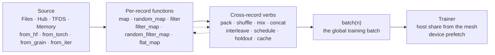
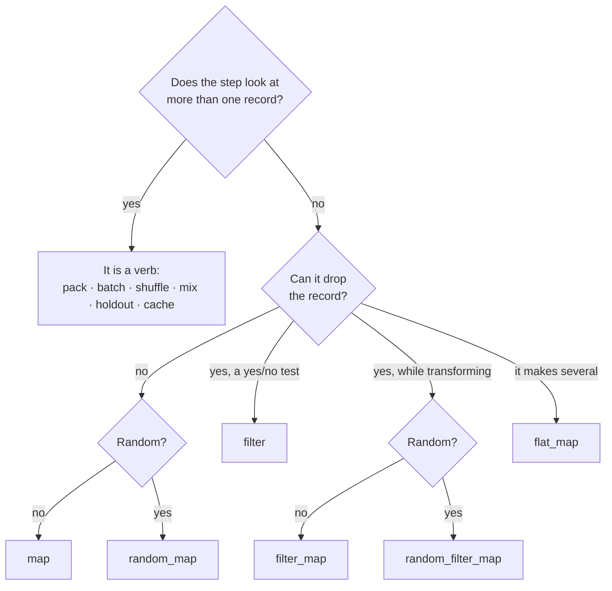
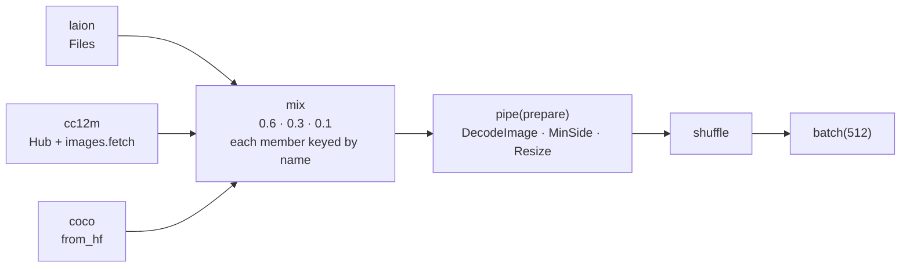
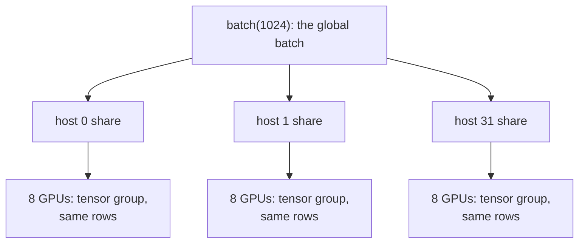
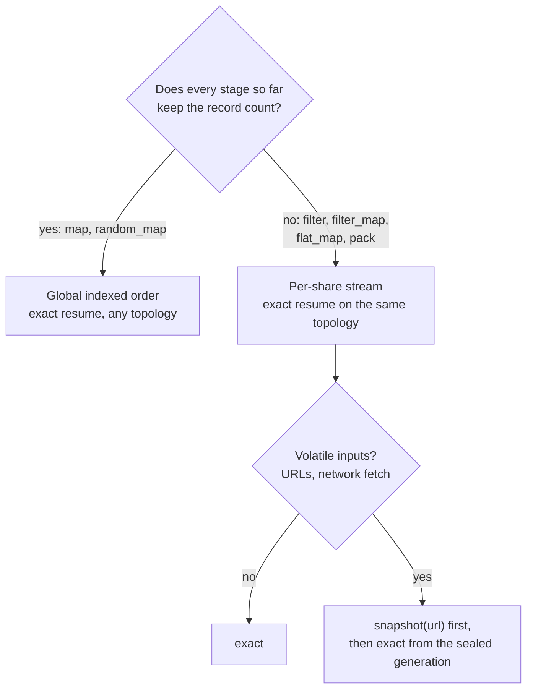

# Data in Dew: one chain, plain functions, Grain underneath

Design record, 2026-10-12. This is the binding design for Dew's data API. The code blocks show the target API; implementation and qualification work lives in the [roadmap](../roadmap.md). This record supersedes the earlier pipeline and data-surface proposals. The execution and storage contracts retained from those proposals are in [section 10](#10-execution-and-storage-contracts).

## 0. The idea in one paragraph

A dataset is one value you chain. A source (`Files`, `Hub`, `TFDS`, `Memory`) is already a dataset. Per-record work is a plain Python function (or a Grain transform) passed to a verb, and the verb's name says how many records come out. Work that needs state across records (packing, batching, shuffling, mixing, splitting, caching) is a verb, never a function. The chain lowers to Grain, so you get Grain's workers, ordering and checkpointable state, and Dew adds the parts Grain leaves to you: mixtures with exact resume, packing with document boundaries, held-out splits, URL storage, online fetching, and sharding derived from the training mesh.

```python
from dew.data import Hub, text

ds = Hub("roneneldan/TinyStories").map(text.tokenize("gpt2", eos=True)).pack(seq_len=512)
train, val = ds.holdout(0.01)
trainer.fit(train.shuffle(seed=0).batch(64), validation=val.batch(64), epochs=1)
```



Stages run in the order you write them. Dew never reorders them.

## 1. Primitives

Three types, six function shapes.

| Type | What it is |
|---|---|
| `Record` | One example: a nested pytree of `np.ndarray`, `str`, `bytes`, numbers, `dict` and `list` (chat messages, tool calls, image payloads, decision objects). At `batch`, numeric and string fields stack as arrays; opaque object fields stay lists. |
| `Rejected(reason)` | What a `filter_map` stage returns to drop a record. Counted by reason. |
| `Dataset` | The one chain type. Immutable and lazy. Every verb returns a `Dataset`; every source is one. |

| Shape | Signature | Verb | Records out per record in |
|---|---|---|---|
| `RecordFn` | `(r) -> r` or a `grain.MapTransform` | `map` | exactly 1 |
| `RandomFn` | `(r, rng) -> r` or a `grain.RandomMapTransform` | `random_map` | exactly 1 |
| `IndexedFn` | `(index, r) -> r`, `index` the record's position in its source; `-> r \| Rejected` where it declares `rejects = True` | `map_with_index` | exactly 1; 0 or 1 where it declares `rejects` |
| `Predicate` | `(r) -> bool` | `filter` (a rejected record counts under the predicate's `reason`) | 0 or 1 |
| `TryFn` | `(r) -> r \| Rejected` | `filter_map` | 0 or 1, with a reason |
| `RandomTryFn` | `(r, rng) -> r \| Rejected` or a `grain.RandomMapTransform` | `random_filter_map` | 0 or 1, with a reason |
| `ExpandFn` | `(r) -> Iterable[r]` (finite) | `flat_map` | any |
| `DatasetFn` | `(Dataset, *settings) -> Dataset` | `pipe(fn, *settings)` | any |

A random step's draw is keyed by the record's place in the run's order, its epoch included: the same in every read mode and reader for one order, and on resume. A different shuffle draws differently, and a read cut per share (one that drops records, or a streamed one) keys a draw by the record's place in its share.



Library stages are values of these shapes. `images.Resize(256)` is a `RecordFn` (and `images.Fit(256)`, which fits an image whole into its square on white, as a web image is shown), `images.Flip(p=0.5)` a `RandomFn`, `images.MinSide(256)` a `Predicate`, `images.fetch()` a `TryFn`. Each is a small frozen value with `__call__`: picklable for worker processes, printable in `show()`, and identified for caching by its configuration and the versions it depends on. Your own function works the same way. A `map` stage that returns `Rejected` raises, naming the stage. Every library step passes through the fields it does not read (`text.tokenize` included); `pack` keeps only the fields it packs, as its `fields=` says. A step reads its field by the record's convention (`jpg`/`png`/`image`, `txt`/`text`/`caption`, `url`, `mp4`) and names it where the convention does not fit: `images.DecodeImage(field="jpg", to="image")`, `images.Resize(field=)`, `images.Processor(field=, to=)`, `images.fetch(url=, to=)`. `text.Normalized(form=, field=)` puts text in one Unicode normal form before it tokenizes. Errors that name the failing stage, field and fix are not built yet for every step.

## 2. Sources

| Source | Reads | Built on |
|---|---|---|
| `Files(url, format=None, where=, columns=)` | Local, `gs://`, `s3://`, `hf://`, R2 (an S3-compatible storage profile), http. Parquet, ArrayRecord, JSONL (`.jsonl.gz`, `.jsonl.zst` too), CSV, Arrow, WebDataset tar. `where=` prunes Parquet row groups before decode. | fsspec, pyarrow, Grain's ArrayRecord and Parquet readers |
| `Hub(repo, name=, split=, columns=, revision=)` | Hugging Face Hub datasets, streamed or prepared. `split=` is HF's own named split. | HF datasets, Hub Parquet shards |
| `TFDS(name, split=)` | TensorFlow Datasets | TFDS ArrayRecord |
| `Memory(records or columns)` | Arrays, lists of dicts, DataFrames | numpy, pyarrow |
| `from_hf(dataset, name=)` | An existing `datasets.Dataset`, its `.map()`s already applied. An `IterableDataset` is named, with its version, since it has no content fingerprint; a shuffled one is refused, because HF drops its shuffle buffer on resume. | HF datasets |
| `from_torch(dataset, identity=None)` | A map-style `torch.utils.data.Dataset` | PyTorch |
| `from_grain(dataset, name=None)` | A Grain `MapDataset` or `IterDataset` | Grain |
| `from_iter(factory, name=None, state=, load_state=)` | Any resumable iterator: WebDataset, torchdata, Mosaic Streaming, Ray | the library's own state |
| `from_iter(factory, replay=True)` | An iterator that reads the same records each time `factory()` opens it | replay to the count read, guarded by the last batch's digest |

A torch, Grain or iterator source holds no content version of its own. Given `name=` (`identity=` for torch), its plan names it, an exact resume finds the same records, and a cache keys it. Given none, it trains as well, but nothing says a later run reads the same records: resuming its position takes `resume="non-exact"`, and a cache of it is refused.

Preparing a Hub dataset happens on first use, with one log line naming what is prepared and its size. `.read("memory" | "indexed" | "streamed")` overrides how it is read.

## 3. Verbs

| Group | Verbs |
|---|---|
| Per record | `map`, `random_map`, `map_with_index`, `filter`, `filter_map`, `random_filter_map`, `flat_map`; `map` and `flat_map` also take `batched=True, batch_size=k` |
| Reuse | `pipe(fn, *args, **kwargs)` for [presets](#5-presets) and your own `Dataset -> Dataset` functions; `grain(fn)` for any Grain operation Dew doesn't name; the plan can't see inside `fn`, so the chain after it reads per share and resumes through Grain's own state |
| Columns | `rename_columns({"old": "new"})`, `select_columns(*names)`, `remove_columns(*names)` (Hugging Face's names) |
| Other | `take(n)`, `named(name)` |
| Sequence | `pack(seq_len, fields=, bins=, segments=, policy=, along=)`, the options every read lays out alike; `text.Chunks(length, overlap=)` cuts long documents first; `windows(seq_len, stride=)` cuts one stream of tokens across documents at a stride, for perplexity over overlapping windows; `shuffle` after `pack` orders the windows |
| Order | `shuffle(seed=, window=)`, `repeat(epochs=)` |
| Combine | `mix(datasets, weights=, by="records" \| "tokens")`, which ends at its first exhausted member, as Grain's does (repeat a member to read on); `concat(datasets)`; `interleave(cycle_length=)` over a store's shards; `schedule([(dataset, tokens), ...])` |
| Split | `holdout(0.01)`, `holdout(val=, test=)`, `holdout(records=)`, `holdout(split="validation" | ("validation", "test"))`, each with `key=`; `holdout(tokens=0.01, fields=("text",))`, the first hundredth of a finite order's tokens, its per-token fields cut together |
| Batch | `batch(n)`, the global training batch; a `map` after it receives the whole batch |
| Persist | `cache(url)` (write-through accelerator), `snapshot(url)` (a terminal job that seals an immutable generation, read back with `Files(url)`) |
| Execution | `workers(n)`, `threads(n)`, `prefetch(n)`, `read(mode)`, `loading(Loading(...))` for every read setting at once |
| Look | `take(n).show()`, `stats(records=n)`, `for record in ds` (one pass, with training's draws) |

Both diagnostics open a fresh reader, never the training stream. `stats` returns counters from at most `n` accepted records and runs before `batch`: the rows delivered and the drops by reason of each corpus, the rows it read a second once its reader was open (loading settings default to none, while workers or prefetching the chain writes run as written), and for token rows the tokens they hold and the share of their places that pad a row. `show` prints the chain, each verb and step a preset or function expanded to, then the first records; it also takes batches. Both handle random and repeated chains. Training logs its own live counters, wait time and throughput.

Batched preprocessing uses Hugging Face's form: `map(fn, batched=True, batch_size=k)` hands `fn` a dict of columns (`{"text": [...k strings]}`). One difference from Hugging Face: there, a batched `map` may return any number of rows; in Dew it must return the same number, and `flat_map(fn, batched=True)` is the one that may change it. The verb keeps saying how many records come out, which is what lets Dew keep exact global resume. A Hugging Face function that changes the row count goes through `flat_map(..., batched=True)` unchanged. The chain stays a stream of records, so `pack`, `mix` and `batch` still follow. After `batch(n)`, a `map` receives the training batch, as in Grain and tf.data.

## 4. Examples

### A first run, then a look before training

```python
from dew.data import Hub, text

ds = Hub("roneneldan/TinyStories").map(text.tokenize("gpt2", eos=True)).pack(seq_len=512)
ds.take(3).show()          # three records: fields, shapes, decoded text
ds.stats(records=10_000)   # records/s, tokens, drops by reason, padding share
```

### Your own preparation, any library

```python
import ftfy
from dew.data import Files, text

def english(r):    return r["lang"] == "en" and len(r["text"]) > 200
def clean(r):      return r | {"text": ftfy.fix_text(r["text"])}
def split_qa(r):   return [{"text": q + a} for q, a in zip(r["qs"], r["as"])]

ds = (Files("s3://corpus/forum/*.jsonl")
        .filter(english).map(clean).flat_map(split_qa)
        .map(text.tokenize(tok)).pack(seq_len=4096))
```

### Batched tokenization, HF style

```python
def tokenize(batch):                           # columns in, columns out, as in HF datasets
    return {"tokens": tok(batch["text"])["input_ids"]}

ds = Hub("HuggingFaceFW/fineweb-edu").map(tokenize, batched=True, batch_size=1024).pack(seq_len=4096)
```

### Images with albumentations or torchvision

```python
import albumentations as A
from dew.data import Files, images, text

aug = A.Compose([A.RandomResizedCrop((256, 256), scale=(0.6, 1)), A.HorizontalFlip()])
ds = (Files("gs://bucket/laion/*.array_record")
        .filter_map(images.DecodeImage())               # reads "jpg", writes "image"; bad bytes are counted
        .filter(images.MinSide(256))
        .random_map(images.Albumentations(aug))    # seeded per record: reproducible and resumable
        .random_map(text.Dropped("caption", p=0.1)))  # caption dropout for guidance
```

### Augmenting on the GPU

```python
ds = (Files("gs://bucket/laion/*.array_record")
        .filter_map(images.DecodeImage())
        .map(images.Resize(256))
        .random_map(images.AugmentationKey())                      # each record draws its own key
        .batch(512)
        .map(images.DeviceAugment(256, crop_scale=(0.6, 1), jitter=True)))   # crop, flip, colour on the GPU
```

The host only decodes and resizes. A device step like `DeviceAugment` runs inside the compiled training step, on each device's shard of the batch: every accelerator crops, flips and colour-jitters its own rows, each image by the key its record drew, so the result is the same on every worker count and after a resume. On an 8-vCPU host this reads about 2.4× the images per second that host-side augmentation reads (512×384 JPEGs to 256 crops).

### Several sources, one downloaded on the fly

```python
from dew.data import Files, Hub, from_hf, mix, images

laion = Files("gs://data/laion12m/*.array_record").named("laion")
cc12m = Hub("pixparse/cc12m-wds", columns=["url", "caption"]).filter_map(images.fetch(timeout=10)).named("cc12m")
coco  = from_hf(load_dataset("detection-datasets/coco", split="train")).map(to_caption).named("coco")

def prepare(ds):
    return ds.filter_map(images.DecodeImage()).filter(images.MinSide(256)).map(images.Resize(256))

train = (mix([laion, cc12m, coco], weights=[0.6, 0.3, 0.1])
           .pipe(prepare)
           .shuffle(seed=0, window=50_000)
           .batch(512))
```



### Train, validation and test with the same preparation

```python
train, val, test = Hub("HuggingFaceFW/fineweb-edu").holdout(val=5e-4, test=5e-4, key="id")
prep = lambda ds: ds.map(text.tokenize(tok, eos=True)).pack(seq_len=8192)

trainer.fit(prep(train).shuffle(seed=0, window=200_000).batch(1024),
            validation={"fineweb": prep(val).batch(256),
                        "c4": prep(Hub("allenai/c4", name="en", split="validation")).batch(256)},
            tokens=1e12)
```

`holdout` hashes the record's identity (`key=`, or the whole source record) before any stage, so a document lands in the same split on every run, machine and resume, and never in two.

### A staged frontier pretraining run

A schedule's stages switch on the run's committed-token clock; `phases` switch at the training steps they name.

```python
pretrain = mix(sources, weights=[.75, .12, .05, .05, .03], by="tokens").map(text.tokenize(tok)).pack(seq_len=8192)
anneal   = mix(high_quality, weights=[.40, .25, .15, .15, .05], by="tokens").map(text.tokenize(tok)).pack(seq_len=8192)
longdocs = long_docs.map(text.tokenize(tok)).pack(seq_len=8192)

data = schedule([
    (pretrain.shuffle(seed=0, window=10**6).batch(1024), 13e12),
    (anneal.shuffle(seed=1, window=10**6).batch(1024),   0.5e12),
    (longdocs.batch(1024),                               0.1e12),
])
trainer.fit(data, validation=val)
```



```mermaid
gantt
  dateFormat X
  axisFormat %s
  section Committed tokens (T)
  pretrain mix, 8k      :0, 13000
  anneal mix, 8k        :13000, 13500
  long documents, 8k    :13500, 13600
```

Each stage runs for its committed valid target tokens, the same clock as `fit(tokens=)`, and ends at the step whose commit reaches them, on every process alike: the trainer reads the committed tokens before each step while a stage's end lies ahead, and at the end opens the stream again where that step left it, so what the prefetch worker read past the end is dropped untrained. The saved position holds where each finished stage ended, and a resume reads the stages after it from there. A corpus shared between stages continues from where the earlier stage left it. A stage that one step's commit passes reads nothing, and the last stage runs on (`None`) or ends the data at its own tokens, the run's token budget then (the first reached, beside `fit(tokens=)`). Every stage reads rows the objective reads, one sequence length for a language model's. While a stage's end lies ahead the trainer waits for each step's count before the next, as a token budget does.

### Offline preparation, published once

The language, quality, classifier and decontamination steps run DataTrove's filters, with the `curation` extra: `text.Language`, `text.Quality` (Gopher's, C4's or FineWeb's rules), `text.Classifier` (a fastText model) and `text.Decontaminated` (n-grams shared with evaluation texts). Each drops a record with the reason its filter names, and each is keyed in the plan by its rules and its model. A snapshot that deduplicates (`text.NearDuplicates`, FineWeb's MinHash rule by default) runs DataTrove's four MinHash stages over the one pass it seals, and its manifest records the rule and the records removed.

```python
cleaned = (Files("s3://raw/dclm/**/*.jsonl")
   .filter_map(text.Language(("en",), min_score=0.65), text.Quality("fineweb"),
               text.Decontaminated(against=EVAL_TEXTS)))
cleaned.snapshot("s3://text/v3/web/", deduplicate=text.NearDuplicates())   # a sealed generation

web = (Files("s3://text/v3/web/")                  # tokenized as training reads it back
   .map(text.tokenize(tok, eos=True)))
```

### Aligned video and audio

```python
clips = (Files("gs://av/catalog.parquet")
           .filter_map(video.fetch())
           .random_filter_map(video.PickClip(seconds=2.0))  # writes one start/stop descriptor
           .filter_map(video.DecodeVideo(frames=32, fps=16, size=256, min_size=128))  # reads the descriptor; drops clips under 128 px
           .filter_map(audio.DecodeAudio(sample_rate=16_000, missing="silence")))  # reads the same descriptor
```

Both decoders read one clip descriptor, so the frames and the waveform cover the same time window. With `missing="silence"`, a clip without sound gets a zero waveform and `audio_valid` false; the default, `"reject"`, drops it. Audio features come from the model's audio conditioner, not from a data step.

### Grain, Hugging Face, PyTorch and iterators, unchanged

```python
ds = from_grain(grain.MapDataset.source(my_source)).map(my_grain_transform)
ds = from_hf(load_dataset("...").map(my_hf_fn, batched=True))
ds = from_torch(my_torch_dataset).map(to_record)
ds = from_iter(lambda: wds.WebDataset(urls), state=..., load_state=...)
ds = ds.grain(lambda d: grain.experimental.ZipIterDataset([d, other]))   # any Grain op
```

## 5. Presets

A preset is a ready chain for one common job, built only from the steps on this page. It is a plain `DatasetFn`: a function that takes a dataset, then its settings, and returns a dataset. `pipe` passes the settings through, so the built-in presets and your own have one shape. Each built-in ends in `batch`, so its result goes straight to `fit`. `show()` lists the steps a preset expanded to.

```python
from dew.data import TFDS, presets

train, val = TFDS("oxford_flowers102", path=data_path).holdout(split="validation")
trainer.fit(train.pipe(presets.images, 64, batch=16, augment=True),
            validation=val.pipe(presets.images, 64, batch=16),
            steps=1000)
```

Training and validation use the same preset, so both are prepared the same way. Augmentation is off unless you ask for it, so a validation split never gets it by accident. There are no train or eval variants. Presets live in `dew.data.presets`; `images`, `text`, `chat`, `video` and `audio` hold only steps.

The public image decoder also reads prepared ArrayRecord byte maps: `shape` holds two int32 dimensions, `image` holds RGB uint8 pixels, and `label` and UTF-8 `caption` are optional. It reads encoded `jpg`/`txt` byte maps through the same step. By default, `filter_map(images.DecodeImage())` counts and drops bad images; `.map(images.DecodeImage(rejects=False))` fails on bad bytes and keeps every source position.

`images.caption(template, classes=names)` formats a class label; `images.caption(columns=("description", "text"))` picks the first present column. To draw one of several templates per record, use `.random_map(images.caption(templates=("a {label}", "a photo of {}"), classes=names))`.

| Preset | Reads per record | Writes per batch |
|---|---|---|
| `images(ds, size, *, batch, augment=False, crop_scale=(1, 1), field="image", staging_size=None, draft=False, rejects=True, caption=None, cache=None, records=None, host=())` | `field`: encoded bytes or uint8 `[H, W, 3]` | `image` uint8 `[B, size, size, 3]`; with `caption`, `caption` |
| `lm(ds, tokenizer, *, seq_len, batch, field="text", eos=None, pack="first-fit", bins=32, stride=None, cache=None, records=None, host=())` | `field`: a string; with `tokenizer=None`, token ids under `text`, such as a token store's documents | `text` int32 `[B, seq_len + 1]`; packed, `text_coordinates`, the windows' documents (`dew.batch.Coordinates`) |
| `token_windows(ds, *, seq_len, batch, stride=None, records=None, host=())` | a token store (`TokenFiles`), shuffled, repeated or taken at most | `text` int32 `[B, seq_len + 1]`, windows `stride` apart in the store's stream |
| `sft(ds, tokenizer, *, seq_len, batch, messages="messages", long="chunk", pack="first-fit", bins=32, cache=None, records=None, host=())` | `messages`: chat turns | the `lm` fields and `text_roles` int8 `[B, seq_len + 1]` ([post-training batches](#post-training-batches)) |
| `clips(ds, seconds, *, frames, fps, size, batch, sample_rate=None, margin=0, context=0, missing="silence", rejects=True, records=None, host=())` | `mp4`: bytes | `video` uint8 `[B, frames, size, size, 3]`; with `sample_rate`, `audio` float32 `[B, samples]` and `audio_valid` bool `[B, samples]` |
| `video(ds, seconds, *, frames, fps, size, batch, caption="", extensions=(".mp4", ".avi", ".mov", ".webm"), ...)` | a listing of media files (`Files(url, format="files")`, cut to `extensions`), or rows with `path` or `video_path` | the `clips` fields, with each row's caption, `caption` where it states none; its other settings are `clips`' |
| `prompts(ds, tokenizer, *, max_prompt_len, batch, pad_id=0, long="truncate", thinking=None, reward_bytes=None, cache=None, records=None, host=())` | `prompt`: a string or chat turns; `data_source`, `ground_truth`, `extra_info` for the reward | `prompt` int32 `[B, max_prompt_len]` left-padded, `prompt_length` int32 `[B]`, and the three reward fields as int32 UTF-8 bytes `[B, reward_bytes]` ([post-training batches](#post-training-batches)) |
| `preferences(ds, *, seq_len, batch, pad_id=0, cache=None, records=None, host=())` | `chosen`, `rejected`: token ids, with `chosen_mask`, `rejected_mask` | each laid out in `seq_len` tokens with its mask (`preferences.PreferencePair`; [post-training batches](#post-training-batches)) |
| `canvas(ds, tokenizer, *, prompt_length, canvas_size, batch, canvases=1, pad_id=0, messages="messages", cache=None, records=None, host=())` | `messages`: chat turns | each assistant turn one block-diffusion row: its prompt in `prompt_length` tokens, its response in `canvases` canvases of `canvas_size`, EOS filling its last canvas and `pad_id` the rest; longer ones keep their first tokens |

- A `lm` or `sft` row holds `seq_len` inputs and their next-token targets.
- `images` and `clips` pass every other field through, stacked per batch: `label` becomes `[B]`, `caption` a list of `B` strings.
- `lm` packs first-fit (`bins` rows open at once), best-fit or by concatenation (`pack=`), every cut through a document overlapping by one token so each next-token target stays whole; `pack=None` joins the documents into one stream of tokens and cuts it into windows `stride` apart instead, which carry no document coordinates; a token store's windows read its stream by index. `eos=None` ends a document with the tokenizer's EOS where it has one. A token store whose documents end nowhere (no document index, no EOS) is not packed, alone or among other sources, since its pieces would be no producer's documents; its stream still reads as windows.
- `text.train_tokenizer(ds, base, path, vocab_size=)` trains a tokenizer on a chain's text by `base`'s algorithm and saves it at `path`, which `lm`, `sft` and `text.tokenize` then read.
- `sft` cuts a conversation longer than a row into pieces that keep every turn (`long="chunk"`), cuts it at its end (`"truncate"`) or drops and counts it (`"drop"`).
- `prompts` keeps a longer prompt's last `max_prompt_len` tokens (`long="truncate"`) or drops and counts it (`"drop"`). Its reward fields are `reward_bytes` wide; left unset, a memory read measures the widest reward string each store holds, over the whole store below any holdout so every part pads alike, and a mixture reads at its widest store's. Another read needs it given, or stated by the store's metadata.
- `lm` and `sft` pack several documents into one row, so a per-document field has no row to land in. They keep only the fields they write. To pack a per-token field of your own along, write the chain with `pack(fields=)`.
- `augment=True` crops to `crop_scale` of the area, flips and colour-jitters on the accelerator, as in [Augmenting on the GPU](#augmenting-on-the-gpu); an `images.DeviceAugment(size, crop_scale=, flip=, jitter=)` value sets those itself. `augment=` also takes your own random step or a tuple of them, such as `images.Albumentations(aug)` or `images.RandomCrop(size, scale=)`, which run on the host right after the resize.
- `staging_size=` resizes to a larger square first, for an augmentation that crops to `size`; `draft=True` decodes a JPEG at a reduced scale no smaller than it. A TFDS store decodes its images itself unless it is given `decoders={field: tfds.decode.SkipDecoding()}`; with that, the preset decodes the bytes, drafting and counting what does not decode as it does for every other store. `rejects=False` stops the run on an image that does not decode instead of counting and dropping it.
- `caption=images.caption(...)` writes each record's caption after the resize, with the source's class names (`class_names.label` in its metadata) where it names none; with `templates=` it draws one per record.
- `records=n` keeps `n` prepared records before the batch, as a validation split's `take(n)`; `host=` steps read each batch on the host, before any step on the accelerator. Every preset takes both. `batch=None` leaves the rows unbatched, for corpora laid out each alone and then mixed or phased, batched after (`phases(...).batch(n)`); host steps and an accelerator augmentation read batches, so they need `batch=`.
- `clips` draws a window `margin` seconds clear of the media's ends and its sound `context` seconds wider on each side; `missing="reject"` drops media without sound instead of filling silence, and `rejects=False` stops the run on media that is too short or does not decode.
- `canvas` never packs: the objective splits each row at `prompt_length`. A tokenizer with no EOS cannot end a response, and is refused.
- `cache=url` (or a `Cache`, or a published `Generation`) caches the preset's fixed steps: decode, resize and a fixed caption, tokenize, or render, and for a packing `lm` and for `sft` the cut into the pieces a row holds, so their cache is one `seq_len`'s (and for `sft` one `long`'s). Augmentation, a drawn caption, packing and batching run after the cache. A generation `publish`ed from a first-fit `lm`'s or chunking `sft`'s own unbatched rows (`batch=None`) stands in for its pack with its packing plan; it holds the pieces its steps kept, not one row for each input, so a chain reading it orders the rows after the preset (`.shuffle(seed).repeat().batch(n)`), where a `Cache` also reads a shuffle written before the preset. The cache holds each input's outputs whatever order reads it, so a `shuffle`, `repeat` or `take` written before the preset reads the cache as it reads the inputs, in indexed and memory reads; a streamed read fills its cache shard by shard and refuses a view before it. A step that drops or expands records before such a view is refused, and is tracked in the roadmap. A memory read runs the steps written before the first view over the whole source first, as it does without a cache, and the cache holds the steps after it.

### Post-training batches

The chat, preference and prompt presets write these batches, which the SFT, preference and RL objectives read ([post-training](post-training.md#1-data) says what each objective does with them). `RenderChat` renders the messages and optional tool schemas with the tokenizer's chat template, and writes the role of each id beside it: 0 padding, 1 system, 2 user, 3 assistant, 4 tool and 5 developer. Packing carries ids and roles through one document-coordinate plan, and a chunking or truncation step cuts every aligned field together.

| Key | Shape | Dtype | Content |
|---|---|---|---|
| `text` | `[B, S+1]` | int32 | Packed conversation ids |
| `text_coordinates` | `Coordinates`, `[B, S+1]` leaves | int32/bool | Document membership, padding and positions |
| `text_roles` | `[B, S+1]` | int8 | Role per id, 0 on padding |

A preference pair holds `chosen` and `rejected` token-id lists, with `chosen_mask` and `rejected_mask` marking the completion tokens; a missing mask marks the whole sequence as completion. The transform pads each pair together, and choosing `seq_len=S+1` prepares the row width `DPOObjective(..., seq_len=S)` reads.

| Key | Shape | Dtype | Content |
|---|---|---|---|
| `input_ids` | `[B, 2, S+1]` | int32 | Chosen at pair index 0, rejected at 1 |
| `completion_mask` | `[B, 2, S+1]` | int32 | Completion marks aligned with the ids |

`RenderPrompt` accepts a message conversation, a string or an id sequence, and encodes each row to a left-padded window of ids and its length. The reward columns become fixed-width UTF-8 byte arrays, so every leaf survives the device transfer; a missing reward field becomes an empty string.

| Key | Shape | Dtype | Content |
|---|---|---|---|
| `prompt` | `[B, max_prompt_len]` | int32 | Prompt ids, left-padded |
| `prompt_length` | `[B]` | int32 | Real ids in each prompt |
| `data_source`, `ground_truth`, `extra_info` | `[B, reward_bytes]` | int32 | The reward's fields as UTF-8 bytes |

### Where the rest of the chain goes

| You want | Where it goes |
|---|---|
| `shuffle`, `mix`, `interleave`, `filter`, `take`, your own `map`s | Before the preset. They act on records. |
| Augmentation | `augment=` on the training split's preset |
| `workers`, `threads`, `prefetch` | After the preset. They set how the chain up to that point runs, so the preset's decode, resize, pack and batch run in the workers; where its steps can drop records, the workers run up to its pack or batch (section 6). |
| A function on whole batches | After the preset. A host `map` after `batch` runs last, in the training process; a device step such as the GPU augmentation runs inside the compiled step. |
| `snapshot` | A separate job before training, read back with `Files(url)` |

```python
data = (train.shuffle(seed=0)
             .pipe(presets.images, 256, batch=64, augment=True, cache="gs://cache/photos")
             .workers(16)
             .prefetch(4))
```

### One preparation, then the splits

`holdout` assigns each record by its source identity, wherever it sits in the chain. Write the shared steps once, then split; each part keeps them.

```python
from dew.data import Hub, images, presets

photos = (Hub("user/photos", columns=["jpg", "caption", "id"])
            .filter_map(images.DecodeImage())                     # shared by every split
            .filter(images.MinSide(256))
            .map(images.caption("a photo of {caption}")))
train, val, test = photos.holdout(val=0.01, test=0.01, key="id")

trainer.fit(train.pipe(presets.images, 256, batch=64, augment=True),
            validation=val.pipe(presets.images, 256, batch=64))
```

A dataset with named splits works the same way: `train, val, test = flowers.holdout(split=("validation", "test"))` returns the source's own split (`train` by default), then each named split in order.

### Your own preset

A preset of your own is a plain function, and it can build on a built-in one:

```python
def flowers(ds, size, *, batch, augment=False):
    return (ds.map(images.caption("a photo of a {label}", classes=FLOWER_NAMES))
              .pipe(presets.images, size, batch=batch, augment=augment))

train.pipe(flowers, 64, batch=16, augment=True)
```

## 6. Workers and parallelism

```python
ds = (Files("gs://data/laion/*.array_record").threads(32)   # read parallelism at the source
        .filter_map(images.fetch(threads=64))                # an IO stage's own thread pool
        .filter_map(images.DecodeImage())
        .random_map(images.Albumentations(aug))
        .workers(16)                                          # everything above runs in 16 processes per host
        .map(to_model_fields)                                 # cheap reshaping in the main process
        .prefetch(4)
        .batch(512))
trainer.fit(ds, device_prefetch=2)                            # batches already placed on the GPUs
```

`.workers(n)` splits the chain where you put it: heavy decoding and augmentation go before it, cheap work after. A chain whose steps can drop records (a filter, a rejecting step, an expansion, a cache read as each input's outputs, a Grain step of your own) is split earlier: the workers run its steps and repeats up to the first that lays out, mixes or batches records, or shuffles, slices or takes them after a drop, and hand on a marker for each record they drop, which the training process drops and counts before running the rest. A worker whose share of the inputs is all dropped then still hands rows on, so it never holds up the others, as Grain advises for a pipeline that filters in its workers. A mixture's corpora each read in an equal share of the workers, or in the workers a corpus writes itself. A Grain step of your own runs in the workers over indexed rows, where what it drops reads as a marker; over a stream the workers hand on before it, and one that turns indexed rows into a stream runs in the workers with what it drops unmarked, so if it drops every one of a worker's inputs that worker holds the others up. Settings are per host. Per-share iterator state records worker and interleave counts; changing them needs an elastic order, as described in section 10. Defaults are fixed numbers or sized from host memory by Grain's `pick_performance_config` with `Loading(workers="auto")`. The [roadmap](../roadmap.md#data) tracks settings measured against step time. A host `map` after `batch` always runs last, in the training process. A device step runs inside the compiled step, so the reader only ever yields numpy.

## 7. Training on a mesh

```python
mesh = jax.make_mesh((32, 8), ("fsdp", "tensor"))     # or MeshSpec(fsdp=32, tensor=8)
trainer = Trainer(objective, optimizer=adamw(3e-4), mesh=mesh)
trainer.fit(data, validation=val)                     # the same chain as on one GPU
```



`batch(n)` is the global batch. Each host reads only its share, derived from the mesh's data-parallel axes (the `activation_batch` rule); devices in one tensor, sequence or stage group read the same rows. The memory planner picks micro-batches, so the same `batch(1024)` works on 8 GPUs or 256. The checkpoint stores the data position. The lowering determines whether that position can move to another host count, as described in section 10.

## 8. Exactness, caching and snapshots



- `cache(url)` is a bounded write-through accelerator. It speeds up repeated reads and never freezes inputs or failures.
- With no `cache=`, a memory or indexed read caches its chain's leading deterministic maps on its own when one of them costs more to run than its records cost to read back and makes them from the record alone (a step that is `Costly`: a learned tokenizer's encoding), in `$DEW_DATA_CACHE`, else `data` in Dew's cache directory, under the same bound and eviction, in a root the process may write. Its maps stop before a step that reads storage a record names by path (`External`: an image, video or audio decode of a path), which the record's content does not key, so a file replaced at the same path reads anew. A run reads the same records and keeps the same plan with it or without it, and where its local storage fails, or a record holds a value the codec cannot write, it reads on uncached; once a pass has read every record, the next run of the same maps over the same records reads them back. `python tools/benchmark_data.py caching --workload {bpe,images,fields} --read {indexed,memory}` measures one finite pass read to its end computed, filling a cache and read back from the generation the fill published, each pass a fresh compile and every arm required to read each record once, the records the computed pass read: on an 8-core armada host 2000 documents of 700 words through a learned 4,000-token BPE took 1.3-1.6 s computed against 0.76-0.81 s read back by index and 3.0 s against 0.48-0.62 s in a memory read, the filling pass 1.6-2.3 times the computed one; 2000 PNGs decoded and resized 1.7 s against 1.7 s, so a decode is not `Costly`, besides an image a record names by path being read from storage its content does not key; a field selection of 16 records 0.03-0.04 s against 0.07 s. A map that rejects in a read by index (its cache is read back as a stream), a step with no identity, a volatile step, a store that names no content, a streamed read and a dirty checkout cache nothing. `Loading(cache=False)` turns it off for a run and `DEW_DATA_CACHE=off` for the process.
- `snapshot(url)` seals an immutable generation, including fetch outcomes and dedup results. A run that pins it resumes exactly.
- A pool reads fetched records in one of two orders (`tests/test_multiprocess.py`). Fetched after the shuffle, each process fetches its own share, pass after pass, and the pool resumes on its own topology. Read from memory, every process fetches the whole catalog when the chain compiles and shuffles what it kept into one global order, which trains as the same records held locally do and whose count resumes on any number of processes, each fetching the catalog again as it compiles. Either replays exactly only while the server answers as it did: a pool whose processes kept other records is refused before it trains, while bytes that changed under the same records are read as they come. A sealed `snapshot(url)` replays without the server.
- Random stages draw from per-record keys, so augmentation is the same on every thread count and after a resume. Libraries with global RNG state (torchvision, albumentations) run through adapters that make seed and call one transaction.

## 9. Performance

Adjacent record steps (`map`, `filter`, `filter_map`, `random_map`, `flat_map`, `map_with_index`) lower as one Grain operator, as tf.data fuses maps and filters: one call per record for the run, so a step written after a filter runs where the steps before it do, on the read's threads or in its workers, and a run's one random step draws what it draws lowered alone. Dew passes `where=` predicates to the Arrow reader and runs `batched=True` maps over columns. The target is to beat plain Grain on every workload; each gate is published with its measurement. Measurements recorded with this design: planned text packing is 0.929× plain Grain on an A100, images 0.91 to 1.04×, and online CC3M fetch 45.5 images/s against 42.7 for the old loader. On four armada CPUs (2026-10-26, medians of five rounds against the unfused lowering in the same container), five record steps around a filter read 1.11× as many rows a second fused; a decision corpus of one JSON-lines file, streamed, read 1.8× and 2.6× the rows of no workers in two and four workers, where a read by more workers than its one shard was refused; and automatic loading read images as fast in four workers, one for each CPU, as in the eight the machine's core count gave Grain's pick.

## 10. Execution and storage contracts

These contracts govern the executor behind the `Dataset` surface. The chain is the one data API: a run reads the chain it is given, and run.json records it (`dew.data.records`). What the removed run-layer recipes chose for a run, a chain states:

- Order: `shuffle(seed)` and `repeat()` before the preset, or for packed rows after it (`presets.lm(..., batch=None)`, then `.shuffle(seed).repeat().batch(n)`); a streamed read shuffles in a window, `shuffle(seed, window=n)`.
- Holdouts: none unless written: `holdout(records=n)`, a hash fraction `holdout(f)`, `holdout(tokens=f)` or a store's own `holdout(split=name)`. A recipe's index fraction is `holdout(records=int(rows * f))` over the store's stated rows. A validation chain states its own settings: a token store's validation windows a window apart, `records=n` for a count.
- Defaults that differ from the recipes': `lm` packs first-fit with 32 open rows (`pack=None` reads plain windows); `images` neither augments nor stops on an image that does not decode (`augment=`, `rejects=False`) and decodes JPEGs whole (`draft=True`); `clips` fills missing sound with silence and drops what does not decode (`missing="reject"`, `rejects=False`); `host=(images.EncodeCaptions(),)` drops the caption strings a model does not read, and `EncodeCaptions(keep=CAPTIONS)`, a diffusion objective's own, keeps them beside as host text under the field `CAPTIONS` (`dew.data.images`, "captions") names, for a metric or reward to read.
- Caches: a preset's cache is keyed by its layout; for one shared across `seq_len`, cache the tokenized or rendered documents and pipe the cached chain (`ds.map(text.tokenize(tok)).cache(url).pipe(presets.lm, None, seq_len=...)`).
- Stores: a Hub or TFDS dataset is `Hub(...)`/`TFDS(...)` or an `hf://`/`tfds://` URL (`dew.data.sources.source`); a TFDS image store is given `decoders={field: tfds.decode.SkipDecoding()}` for the preset to decode and draft its images. A token store is a committed export (`dew data export --tokenizer`, `text.export_tokens`), one split each; a `train.bin`/`meta.json` directory's ids are written once as one, its documents under `text` (`dew.data.sinks.export(rows, url, format="array_record", length_field="text", metadata={"token_store": True, "tokenizer": ..., "vocab_size": ..., "dtype": "int32", "eos_id": ...})`).

Dropped with the recipes, deliberately: the random record holdout, the default holdouts (the first 256 records, or a hundredth of the tokens) and `load()`'s named sources.

### Lowering and positions

The chain is analyzed once before readers open. Its plan chooses the lowering and records the facts that determine record order. The compiler resolves each configured factory once, refusing a missing key by name; the resolved step and the values it read enter the saved plan and cache key. `random=True` declares a random factory before it is resolved, so ordering and cache checks do not depend on opening data. Run-scoped metadata merges slot maxima across the training and validation branches compiled together; the validation chains `fit` compiles apart do not share them yet.

| Lowering | Order and saved position | Resume |
|---|---|---|
| Global | Indexed or memory reads whose order is known globally; one global record count | The same global order can be divided among a different number of readers. |
| Per share | Streams and online count-changing stages; Grain's iterator state for each share | Share, worker and interleave topology stay as recorded. |
| Provisioned | A filtered or packed read whose rows, and a terminal pack's plan, are published once as a generation (`dew data publish`) and read back by index (`.cache(generation)`); a source whose index is provisioned (`dew data provision`) read by index, where every later step keeps a global order (no filter, flat map, windows, online packing or workers before the batch): it lowers to the global order | A new run resumes on any number of readers, as the global order does; a checkpoint a per-share read saved still resumes only on its own topology, and its refusal names this preparation. Resuming an unprepared per-share read on other readers is ledger row 1597, not built. |

A streamed file source exposes physical shards with immutable identities. The manifest is the sliceable root; readers and Grain workers take disjoint slices and interleave their shard readers. JSONL ranges start at line boundaries, and a JSONL or text store of fewer shards than its readers × workers is cut into that many, each the lines that start in an even cut of a file, as Hadoop splits a text file, so a corpus of one small file reads through every worker. CSV shards are whole files because a quoted field may contain a newline; indexed CSV uses a parser-built index. Parquet uses footer and row-group metadata. A pinned Hub revision names the bytes actually read; resolving a converted branch records that branch's revision.

Indexes, accepted counts, lengths and packing plans come from producer metadata or an explicit preparation job. Memory mode may compute them from its resident records. Training startup may scan a source when `fit` provisions its missing index, which it does where the source can build one, and otherwise reports the read mode it cannot have; a compile with provisioning off suggests `dew data provision` or `provision=True`. Refusing a missing artifact before any read, with its name, its size where the store states it and the command to provision it, is not built yet. Length grouping reads lightweight length metadata; global packing at scale reads a published sharded plan. Heavy transforms run once per consumed record.

The saved plan includes its format version, lowering, source snapshots, stage identities, order, mixture weights and accounting rule, packing policy, derived-order fingerprints, cache generations, volatility and relevant topology. Changing an algorithm that produces different rows or random draws changes the plan version. Resume checks the plan before opening readers. A global record count can survive an environment change only if its semantic plan and derived order are unchanged; the change is recorded. Per-share replay also needs the same environment.

A callable without a stable identity makes exact replay unavailable. A declared identity is required at a persistent cache boundary; opting into non-exact resume is explicit. A newly completed cache never changes a stopped run's saved lowering or order. Reading its generation is a new run's choice.

### Rejection and accounting

Rejecting stages drop records before mixing and count them by source and reason. Mixture shares count accepted records or committed valid target tokens, as requested. Packing happens per source before token-weighted mixing. With an authoritative per-source valid-token count (a cache generation's index, or a producer's), the lowering weights each source's windows by `weight / mean valid targets a window` from those counts, and pins the counts in the plan. Without one, a checkpointed deficit scheduler selects the source furthest below its requested share; ties go to the lower source index. The deficit rule needs no estimate and no warm-up: the shares hold exactly at every window boundary, to within one window's tokens. It is deterministic, since the counts come from the data, and its state is the per-source delivered counts, saved in the iterator's state beside the sources'. Zero-target windows are rejected before the mix so they cannot stall that scheduler. Each member draws its randomness under its `named()` key; an unnamed member goes by its place among the unnamed members, and two members of one name by their order. A per-share mixture whose later stages keep each member's state (no shuffle window or packer above the mix) resumes across an edit of its member list, each named member at its own position; a global order, or a chain that buffers mixed records, resumes only an unchanged list. Per-member attempted, accepted and rejected-by-reason counts log under that name; per-member committed tokens do not yet.

An epoch budget needs an authoritative accepted count. A finite exhausted source proves emptiness; a diagnostic sample estimates rejection rates only. No count of rejections or of empty shards refuses a read: an endless read reads on through any run of them, logging the corpus, its run and its most frequent reasons at each doubling, and its data metrics show the rows it delivered. An endless read is refused only where it is certain to read nothing forever: a share that holds no rows, a store whose shards state they hold none, or a repeated stream whose pass yields nothing with no step before the repeat that drops a row. Padding or masking a rejected record requires an objective whose loss, gradients, metrics, mutable collections and effects all honor validity, including an all-masked batch.

Long text is chunked before packing. A long conversation is chunked by default, every turn kept; truncating or filtering it is an explicit preparation choice, and every per-position field is cut with the ids it describes. An over-length RL prompt keeps its tail by default; filtering it is an explicit choice, counted as a rejection under its reason. `JointLayout` cuts a decision row's state to `max_state_tokens`, when set, and to the room the framing, media and schema leave; it keeps the schema whole and drops a row that still passes `max_len`. `MarkerLayout` and `StateFirstLayout` also cut question instructions and option text. Each source reports `data/truncated/<source>`, the share of records a preparation stage marked cut (an RL prompt's tail cut is not marked yet); `data/rejected/<source>/<reason>`; and `data/chunks_per_record/<source>` for chunked text. A read warns when a source's rejected share passes `warn_over=` (1% by default).

Validation reads a finite canonical order through the same executor. `take(n)` counts accepted rows before a topology-dependent share cut, so changing the reader count does not change the held-out set. Training-only augmentation and host steps stay on the training chain. Shared steps are written once before the split.

### Cache identity and publication

The artifact key is a canonical dependency manifest: resolved source snapshots and immutable file versions, stages in order, the Dew revision and lock, Python and platform, external stage identities, processor and template revisions, and codec/schema version. A step whose module is not in Dew contributes its qualified name, the sha256 of its module's source file, and a declared `identity="name@version"`; without one the cache refuses it, since the Dew revision does not cover that code. A memory source contributes the sha256 of its records serialized in order. A torch dataset's content cannot be hashed without reading it, so caching one needs `identity=`. A tokenizer and template contribute the resolved repo revision and the sha256 of every file read. A diagnostic recomputation is not proof that a cache is current.

Indexed rows are identified by source index; streamed rows by physical shard and row; expansion outputs by input identity and output number. These identities do not depend on worker ownership or shuffle. A source without immutable identities keeps fills separate by execution plan.

Writers publish immutable shards and segments. Each input has a completion record with its fan-out and output digest, including rejected or empty outputs. A sealed writer certifies its segment sequence. A generation is published only after coverage of every source input, its outputs and referenced shard checksums has been established. The immutable index and packing plan are written first; one conditional manifest update commits them. Readers follow that manifest to a single generation. Missing or corrupt committed objects fail at the read boundary.

An accepted-index manifest certifies only the stages in its prefix. A later rejecting or expanding stage still needs its own lowering. Volatility is declared (`volatile=True`), never inferred from what a step does. The saved plan reads the declaration on map stages; other stage kinds' declarations do not reach it yet. Network fetches remain volatile during training; a cache never freezes a failed fetch. A sealed snapshot records the outcomes and bytes needed for exact replay.

The spool, downloaded-file mirror and retained local generations have separate byte budgets. Active readers pin the files they use. The spool holds transformed shards not yet uploaded, pinned until verified. The mirror holds disposable downloaded shards: least recently used first, with pins for the shards an active reader holds, single-flight downloads and bounded look-ahead. Retained local generations are evicted least recently used among those no running process has open; remote generations are untouched. While a full spool stops admission, the artifact stays filling; some of the paths that stop it log a warning. Uploads retry with backoff through `Store.put_immutable`; `close` cancels queued uploads and abandons unfinished ones, and an upload already in flight may finish after it. The trainer reports data wait (`train/data_wait_ms`). The cache keeps admission, spool, upload and mirror counters. The planned reader report gives `data/cache/admitting`, spool and backlog bytes, upload rate, mirror hit rate and downloaded bytes; it is not built yet. A full spool stops admitting cache writes by default and training continues; blocking is an explicit choice. Upload work belongs to the reader's resource lifecycle and closes with it.

### Storage and native integrations

Sources, cache roots, manifests and sinks take fsspec URLs. Native ArrayRecord and Arrow readers are used where they support the scheme; other schemes use fsspec. Connection setup is resolved at first use. Dew reads storage profiles from `storage.toml` in its configuration directory (`dew.cache.dew_config_dir`), or `$DEW_STORAGE_CONFIG`, on the first `Store.resolve` and registers each named protocol once; a malformed file fails that resolution. Profile URLs work with native fsspec after that. A profile whose environment variable is unset is refused when a URL first uses it, naming the variable. Records also hold the non-secret options (endpoint, region) and never the key. Importing a module does not read storage configuration.

Transport caches use fsspec URL chaining, such as `filecache::s3://example/data/` or `blockcache::hf://datasets/example/data/`. Dew's `dewcache::` adds byte-bounded eviction, reader pins and single-flight downloads. This disposable file cache is separate from transformed artifacts and their dependency manifests.

One publisher commits cache shards and exported datasets. ArrayRecord closes a local shard before uploading it; Parquet uses `pyarrow.dataset.write_dataset`; any other format is a native writer of the caller's, `export(rows, url, format=writer)` (`dew.data.sinks.Writer`), handed the rows as one Arrow stream (`pyarrow.RecordBatchReader`, which Arrow's, Delta's, Lance's and DuckDB's writers take and a Spark session reads as a table) and writing files of a format `Files` reads; Hub writes use a commit with a parent revision. Each sink publishes its manifest after the immutable shards, listing the files its writer wrote without the hidden ones (`_` or `.` first, as Hadoop's checksums are), so a writer that stops leaves nothing committed. Spark and Ray exchange large datasets through Parquet. A `_SUCCESS` marker is written too, so Spark and Hadoop readers see a committed directory. Spark's normal output is a Parquet directory with `_SUCCESS` and `key=value/` partitions; `Files(..., spark=True)` reads it as a `pyarrow.dataset` source with `partitioning="hive"` and refuses a directory without `_SUCCESS` as uncommitted. Delta uses its table log and records the table version; WebDataset reads tar members grouped by key. Resumable library iterators use `from_iter` and the library's own state.

Publication is qualified across interrupted shards, segments and manifest updates, concurrent finalizers, conflicting duplicates, full spools and external upload failures. [Testing](testing.md) owns the shared behavioral requirements. Performance comparisons use the same workload against plain Grain and report accepted throughput, first-batch latency, host memory, transform calls, remote read amplification and device-timeline idle time. Warm-up, compilation and replay are reported separately from steady execution.

On multi-socket hosts, placement is measured with each GPU's data workers and their memory local to its NUMA node. Keep that placement only where the end-to-end workload improves. The offline execution contract places IO-bound stages on thread pools and CPU-bound stages on process pools, with bounded queues providing backpressure; pool and buffer sizes follow the host's cores, memory budget and NUMA layout. Both compose the existing chain and publication path. The [roadmap](../roadmap.md#data) tracks the locality qualification and mixed-stage executor work.
