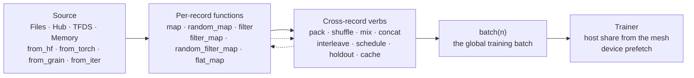
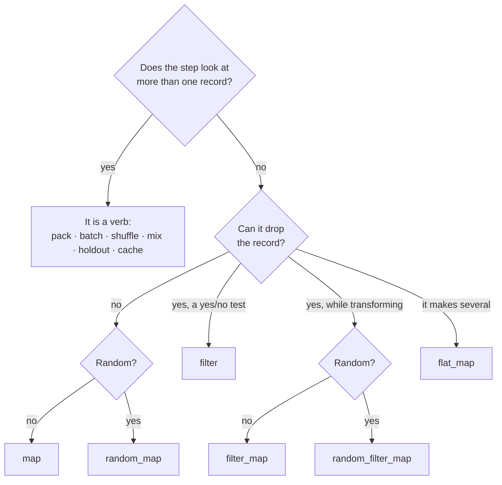
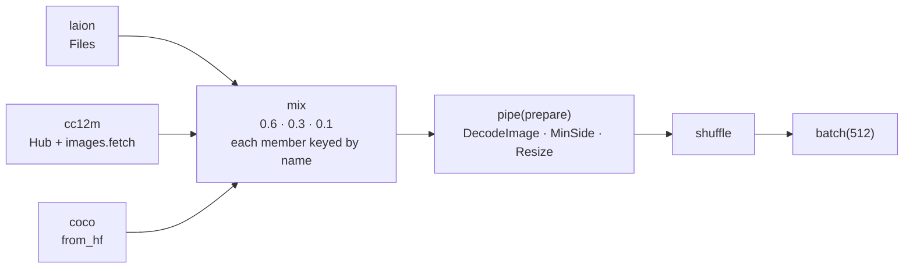
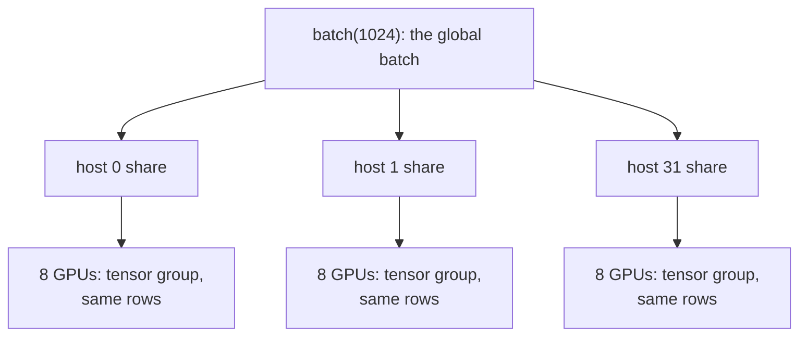
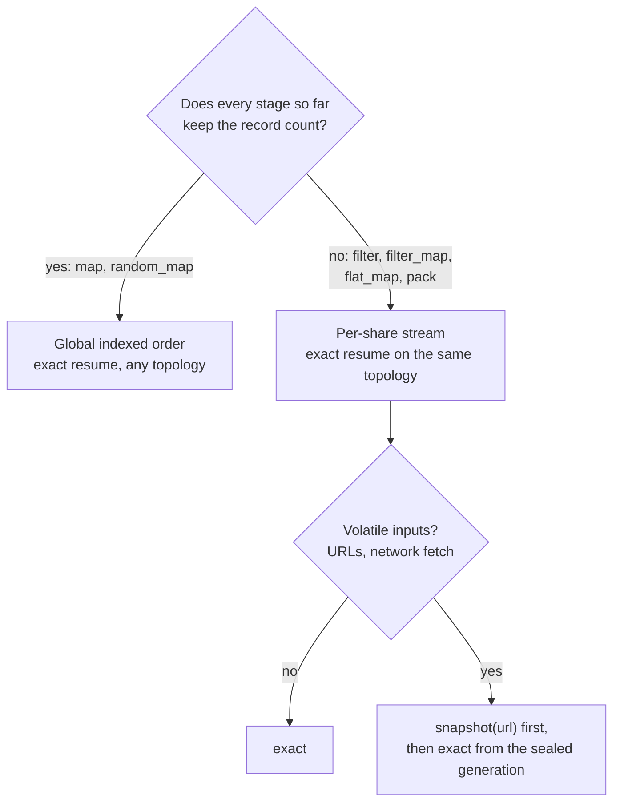

# Data in Dew: one chain, plain functions, Grain underneath

Design record, 2026-10-12. This is the binding design for Dew's data API. The code blocks show the target API; the [status table](#10-status) at the end says what is built and what is planned. The working implementation lives on the `feat/data-fetch` branch.

## 0. The idea in one paragraph

A dataset is one value you chain. A source (`Files`, `Hub`, `TFDS`, `Memory`) is already a dataset. Per-record work is a plain Python function (or a Grain transform) passed to a verb, and the verb's name says how many records come out. Work that needs state across records (packing, batching, shuffling, mixing, splitting, caching) is a verb, never a function. The chain lowers to Grain, so you get Grain's workers, ordering and checkpointable state, and Dew adds the parts Grain leaves to you: mixtures with exact resume, packing with document boundaries, held-out splits, URL storage, online fetching, and sharding derived from the training mesh.

```python
from dew.data import Hub, text

ds = Hub("roneneldan/TinyStories").map(text.tokenize("gpt2", eos=True)).pack(seq_len=512)
train, val = ds.holdout(0.01)
trainer.fit(train.shuffle(seed=0).batch(64), validation=val.batch(64), epochs=1)
```



Stages run in the order you write them. Dew never reorders them.

## 1. Primitives

Three types, six function shapes.

| Type | What it is |
|---|---|
| `Record` | One example: a nested pytree of `np.ndarray`, `str`, `bytes`, numbers, `dict` and `list` (chat messages, tool calls, image payloads, decision objects). |
| `Rejected(reason)` | What a `filter_map` stage returns to drop a record. Counted by reason. |
| `Dataset` | The one chain type. Immutable and lazy. Every verb returns a `Dataset`; every source is one. |

| Shape | Signature | Verb | Records out per record in |
|---|---|---|---|
| `RecordFn` | `(r) -> r` or a `grain.MapTransform` | `map` | exactly 1 |
| `RandomFn` | `(r, rng) -> r` or a `grain.RandomMapTransform` | `random_map` | exactly 1 |
| `Predicate` | `(r) -> bool` | `filter` | 0 or 1 |
| `TryFn` | `(r) -> r \| Rejected` | `filter_map` | 0 or 1, with a reason |
| `RandomTryFn` | `(r, rng) -> r \| Rejected` or a `grain.RandomMapTransform` | `random_filter_map` | 0 or 1, with a reason |
| `ExpandFn` | `(r) -> Iterable[r]` (finite) | `flat_map` | any |
| `DatasetFn` | `(Dataset, *settings) -> Dataset` | `pipe(fn, *settings)` | any |

A random step's draw is keyed by the record's place in the run's order, its epoch included: the same in every read mode and reader for one order, and on resume. A different shuffle draws differently, and a read cut per share (one that drops records, or a streamed one) keys a draw by the record's place in its share.



Library stages are values of these shapes. `images.Resize(256)` is a `RecordFn`, `images.Flip(p=0.5)` a `RandomFn`, `images.MinSide(256)` a `Predicate`, `images.fetch()` a `TryFn`. Each is a small frozen value with `__call__`: picklable for worker processes, printable in `show()`, and identified for caching by its configuration and the versions it depends on. Your own function works the same way. A `map` stage that returns `Rejected` raises, naming the stage.

## 2. Sources

| Source | Reads | Built on |
|---|---|---|
| `Files(url, format=None, where=, columns=)` | Local, `gs://`, `s3://`, `hf://`, R2, http. Parquet, ArrayRecord, JSONL, CSV, Arrow, WebDataset tar. `where=` prunes Parquet row groups before decode. | fsspec, pyarrow, Grain's ArrayRecord and Parquet readers |
| `Hub(repo, name=, split=, columns=, revision=)` | Hugging Face Hub datasets, streamed or prepared. `split=` is HF's own named split. | HF datasets, Hub Parquet shards |
| `TFDS(name, split=)` | TensorFlow Datasets | TFDS ArrayRecord |
| `Memory(records or columns)` | Arrays, lists of dicts, DataFrames | numpy, pyarrow |
| `from_hf(dataset, name=)` | An existing `datasets.Dataset`, its `.map()`s already applied. An `IterableDataset` is named, with its version, since it has no content fingerprint; a shuffled one is refused, because HF drops its shuffle buffer on resume. | HF datasets |
| `from_torch(dataset)` | A map-style `torch.utils.data.Dataset` | PyTorch |
| `from_grain(dataset)` | A Grain `MapDataset` or `IterDataset` | Grain |
| `from_iter(factory, state=, load_state=)` | Any resumable iterator: WebDataset, torchdata, Mosaic Streaming, Ray | the library's own state |
| `from_iter(factory, replay=True)` | An iterator that reads the same records each time `factory()` opens it | replay to the count read, guarded by the last batch's digest |

Preparing a Hub dataset happens on first use, with one log line naming what is prepared and its size. `.read("memory" | "indexed" | "streamed")` overrides how it is read.

## 3. Verbs

| Group | Verbs |
|---|---|
| Per record | `map`, `random_map`, `filter`, `filter_map`, `random_filter_map`, `flat_map`; `map` and `flat_map` also take `batched=True, batch_size=k` |
| Reuse | `pipe(fn, *args, **kwargs)` for [presets](#5-presets) and your own `Dataset -> Dataset` functions; `grain(fn)` for any Grain operation Dew doesn't name; the plan can't see inside `fn`, so the chain after it reads per share and resumes through Grain's own state |
| Columns | `rename_columns({"old": "new"})`, `select_columns(*names)`, `remove_columns(*names)` (Hugging Face's names) |
| Other | `take(n)`, `named(name)` |
| Sequence | `pack(seq_len, fields=, bins=, segments=, policy=, along=)`, the options every read lays out alike; `text.Chunks(length, overlap=)` cuts long documents first; `shuffle` after `pack` orders the windows |
| Order | `shuffle(seed=, window=)`, `repeat(epochs=)` |
| Combine | `mix(datasets, weights=, by="records" \| "tokens")`, which ends at its first exhausted member, as Grain's does (repeat a member to read on); `concat(datasets)`; `interleave(cycle_length=)` over a store's shards; `schedule([(dataset, tokens), ...])` |
| Split | `holdout(0.01)`, `holdout(val=, test=)`, `holdout(records=)`, `holdout(split="validation" | ("validation", "test"))`, each with `key=` |
| Batch | `batch(n)`, the global training batch; a `map` after it receives the whole batch |
| Persist | `cache(url)` (write-through accelerator), `snapshot(url)` (a terminal job that seals an immutable generation, read back with `Files(url)`) |
| Execution | `workers(n)`, `threads(n)`, `prefetch(n)`, `read(mode)` |
| Look | `take(n).show()`, `stats(records=n)` |

Batched preprocessing uses Hugging Face's form: `map(fn, batched=True, batch_size=k)` hands `fn` a dict of columns (`{"text": [...k strings]}`). One difference from Hugging Face: there, a batched `map` may return any number of rows; in Dew it must return the same number, and `flat_map(fn, batched=True)` is the one that may change it. The verb keeps saying how many records come out, which is what lets Dew keep exact global resume. A Hugging Face function that changes the row count goes through `flat_map(..., batched=True)` unchanged. The chain stays a stream of records, so `pack`, `mix` and `batch` still follow. After `batch(n)`, a `map` receives the training batch, as in Grain and tf.data.

## 4. Examples

### A first run, then a look before training

```python
from dew.data import Hub, text

ds = Hub("roneneldan/TinyStories").map(text.tokenize("gpt2", eos=True)).pack(seq_len=512)
ds.take(3).show()          # three records: fields, shapes, decoded text
ds.stats(records=10_000)   # records/s, tokens, drops by reason, padding share
```

### Your own preparation, any library

```python
import ftfy
from dew.data import Files, text

def english(r):    return r["lang"] == "en" and len(r["text"]) > 200
def clean(r):      return r | {"text": ftfy.fix_text(r["text"])}
def split_qa(r):   return [{"text": q + a} for q, a in zip(r["qs"], r["as"])]

ds = (Files("s3://corpus/forum/*.jsonl")
        .filter(english).map(clean).flat_map(split_qa)
        .map(text.tokenize(tok)).pack(seq_len=4096))
```

### Batched tokenization, HF style

```python
def tokenize(batch):                           # columns in, columns out, as in HF datasets
    return {"tokens": tok(batch["text"])["input_ids"]}

ds = Hub("HuggingFaceFW/fineweb-edu").map(tokenize, batched=True, batch_size=1024).pack(seq_len=4096)
```

### Images with albumentations or torchvision

```python
import albumentations as A
from dew.data import Files, images, text

aug = A.Compose([A.RandomResizedCrop((256, 256), scale=(0.6, 1)), A.HorizontalFlip()])
ds = (Files("gs://bucket/laion/*.array_record")
        .filter_map(images.DecodeImage())               # reads "jpg", writes "image"; bad bytes are counted
        .filter(images.MinSide(256))
        .random_map(images.Albumentations(aug))    # seeded per record: reproducible and resumable
        .random_map(text.Dropped("caption", p=0.1)))  # caption dropout for guidance
```

### Augmenting on the GPU

```python
ds = (Files("gs://bucket/laion/*.array_record")
        .filter_map(images.DecodeImage())
        .map(images.Resize(256))
        .random_map(images.AugmentationKey())                      # each record draws its own key
        .batch(512)
        .map(images.DeviceAugment(256, crop_scale=(0.6, 1), jitter=True)))   # crop, flip, colour on the GPU
```

The host only decodes and resizes. A device step like `DeviceAugment` runs inside the compiled training step, on each device's shard of the batch: every accelerator crops, flips and colour-jitters its own rows, each image by the key its record drew, so the result is the same on every worker count and after a resume. On an 8-vCPU host this reads about 2.4× the images per second that host-side augmentation reads (512×384 JPEGs to 256 crops).

### Several sources, one downloaded on the fly

```python
from dew.data import Files, Hub, from_hf, mix, images

laion = Files("gs://data/laion12m/*.array_record").named("laion")
cc12m = Hub("pixparse/cc12m-wds", columns=["url", "caption"]).filter_map(images.fetch(timeout=10)).named("cc12m")
coco  = from_hf(load_dataset("detection-datasets/coco", split="train")).map(to_caption).named("coco")

def prepare(ds):
    return ds.filter_map(images.DecodeImage()).filter(images.MinSide(256)).map(images.Resize(256))

train = (mix([laion, cc12m, coco], weights=[0.6, 0.3, 0.1])
           .pipe(prepare)
           .shuffle(seed=0, window=50_000)
           .batch(512))
```



### Train, validation and test with the same preparation

```python
train, val, test = Hub("HuggingFaceFW/fineweb-edu").holdout(val=5e-4, test=5e-4, key="id")
prep = lambda ds: ds.map(text.tokenize(tok, eos=True)).pack(seq_len=8192)

trainer.fit(prep(train).shuffle(seed=0, window=200_000).batch(1024),
            validation={"fineweb": prep(val).batch(256),
                        "c4": prep(Hub("allenai/c4", name="en", split="validation")).batch(256)},
            tokens=1e12)
```

`holdout` hashes the record's identity (`key=`, or the whole source record) before any stage, so a document lands in the same split on every run, machine and resume, and never in two.

### A staged frontier pretraining run

```python
pretrain = mix(sources, weights=[.75, .12, .05, .05, .03], by="tokens").map(text.tokenize(tok)).pack(seq_len=8192)
anneal   = mix(high_quality, weights=[.40, .25, .15, .15, .05], by="tokens").map(text.tokenize(tok)).pack(seq_len=8192)
longctx  = long_docs.map(text.tokenize(tok)).pack(seq_len=65_536)

data = schedule([
    (pretrain.shuffle(seed=0, window=10**6).batch(1024), 13e12),
    (anneal.shuffle(seed=1, window=10**6).batch(1024),   0.5e12),
    (longctx.batch(128),                                 0.1e12),
])
trainer.fit(data, validation=val, tokens=13.6e12)
```



```mermaid
gantt
  dateFormat X
  axisFormat %s
  section Committed tokens (T)
  pretrain mix, 8k      :0, 13000
  anneal mix, 8k        :13000, 13500
  long context, 64k     :13500, 13600
```

Each stage runs for its committed valid target tokens, the same clock as `fit(tokens=)`. At a boundary, sources shared between stages continue from their own positions; packer and prefetch buffers are dropped and counted; a new sequence length recompiles the step once.

### Offline preparation, published once

```python
(Files("s3://raw/dclm/**/*.jsonl")
   .filter(text.language("en", min_score=0.65))
   .pipe(text.dedup_minhash(threshold=0.8))        # DataTrove's phases
   .pipe(text.decontaminate(against=EVAL_SETS))
   .map(text.tokenize(tok, eos=True))
   .snapshot("s3://tokens/v3/web/"))               # a sealed generation

web = Files("s3://tokens/v3/web/")                 # training reads it back
```

### Aligned video and audio

```python
clips = (Files("gs://av/catalog.parquet")
           .filter_map(video.fetch())
           .random_filter_map(video.PickClip(seconds=2.0))  # writes one start/stop descriptor
           .filter_map(video.DecodeVideo(frames=32, fps=16, size=256))            # reads the descriptor
           .filter_map(audio.DecodeAudio(sample_rate=16_000, missing="silence")))  # reads the same descriptor
```

Both decoders read one clip descriptor, so the frames and the waveform cover the same time window. With `missing="silence"`, a clip without sound gets a zero waveform and `audio_valid` false; the default, `"reject"`, drops it. Audio features come from the model's audio conditioner, not from a data step.

### Grain, Hugging Face, PyTorch and iterators, unchanged

```python
ds = from_grain(grain.MapDataset.source(my_source)).map(my_grain_transform)
ds = from_hf(load_dataset("...").map(my_hf_fn, batched=True))
ds = from_torch(my_torch_dataset).map(to_record)
ds = from_iter(lambda: wds.WebDataset(urls), state=..., load_state=...)
ds = ds.grain(lambda d: grain.experimental.ZipIterDataset([d, other]))   # any Grain op
```

## 5. Presets

A preset is a ready chain for one common job, built only from the steps on this page. It is a plain `DatasetFn`: a function that takes a dataset, then its settings, and returns a dataset. `pipe` passes the settings through, so the built-in presets and your own have one shape. Each built-in ends in `batch`, so its result goes straight to `fit`. `show()` lists the steps a preset expanded to.

```python
from dew.data import TFDS, presets

train, val = TFDS("oxford_flowers102", path=data_path).holdout(split="validation")
trainer.fit(train.pipe(presets.images, 64, batch=16, augment=True),
            validation=val.pipe(presets.images, 64, batch=16),
            steps=1000)
```

Training and validation use the same preset, so both are prepared the same way. Augmentation is off unless you ask for it, so a validation split never gets it by accident. There are no train or eval variants. Presets live in `dew.data.presets`; `images`, `text`, `chat`, `video` and `audio` hold only steps.

The public image decoder also reads prepared ArrayRecord byte maps: `shape` holds two int32 dimensions, `image` holds RGB uint8 pixels, and `label` and UTF-8 `caption` are optional. It reads encoded `jpg`/`txt` byte maps through the same step. By default, `filter_map(images.DecodeImage())` counts and drops bad images; `.map(images.DecodeImage(rejects=False))` fails on bad bytes and keeps every source position, as the run-layer `ImageData` recipe does.

`images.caption(template, classes=names)` formats a class label; `images.caption(columns=("description", "text"))` picks the first present column. To draw one of several templates per record, use `.random_map(images.caption(templates=("a {label}", "a photo of {}"), classes=names))`. `ImageData` composes these same decoding, resizing, caption and augmentation steps; its recorded run settings are unchanged.

| Preset | Reads per record | Writes per batch |
|---|---|---|
| `images(ds, size, *, batch, augment=False, crop_scale=(1, 1), cache=None)` | `image`: encoded bytes or uint8 `[H, W, 3]` | `image` uint8 `[B, size, size, 3]` |
| `lm(ds, tokenizer, *, seq_len, batch, field="text", cache=None)` | `text`: a string | `text` int32 `[B, seq_len + 1]`; `text_coordinates`, the windows' documents (`dew.nn.inputs.Coordinates`) |
| `sft(ds, tokenizer, *, seq_len, batch, cache=None)` | `messages`: chat turns | the `lm` fields and `text_roles` int32 `[B, seq_len + 1]` |
| `clips(ds, seconds, *, frames, fps, size, batch, sample_rate=None)` | `mp4`: bytes | `video` uint8 `[B, frames, size, size, 3]`; with `sample_rate`, `audio` float32 `[B, samples]` and `audio_valid` bool `[B, samples]` |

- A `lm` or `sft` row holds `seq_len` inputs and their next-token targets.
- `images` and `clips` pass every other field through, stacked per batch: `label` becomes `[B]`, `caption` a list of `B` strings.
- `lm` and `sft` pack several documents into one row, so a per-document field has no row to land in. They keep only the fields they write. To pack a per-token field of your own along, write the chain with `pack(fields=)`.
- `augment=True` crops to `crop_scale` of the area, flips and colour-jitters on the accelerator, as in [Augmenting on the GPU](#augmenting-on-the-gpu). `augment=` also takes your own random step, such as `images.Albumentations(aug)`, which runs on the host right after the resize.
- `cache=url` caches the preset's fixed steps (decode and resize, or tokenize). Augmentation, packing and batching run after the cache.

### Where the rest of the chain goes

| You want | Where it goes |
|---|---|
| `shuffle`, `mix`, `interleave`, `filter`, `take`, your own `map`s | Before the preset. They act on records. |
| Augmentation | `augment=` on the training split's preset |
| `workers`, `threads`, `prefetch` | After the preset. They set how the chain up to that point runs, so the preset's decode, resize, pack and batch run in the workers. |
| A function on whole batches | After the preset. A host `map` after `batch` runs last, in the training process; a device step such as the GPU augmentation runs inside the compiled step. |
| `snapshot` | A separate job before training, read back with `Files(url)` |

```python
data = (train.shuffle(seed=0)
             .pipe(presets.images, 256, batch=64, augment=True, cache="gs://cache/photos")
             .workers(16)
             .prefetch(4))
```

### One preparation, then the splits

`holdout` assigns each record by its source identity, wherever it sits in the chain. Write the shared steps once, then split; each part keeps them.

```python
from dew.data import Hub, images, presets

photos = (Hub("user/photos", columns=["jpg", "caption", "id"])
            .filter_map(images.DecodeImage())                     # shared by every split
            .filter(images.MinSide(256))
            .map(images.caption("a photo of {caption}")))
train, val, test = photos.holdout(val=0.01, test=0.01, key="id")

trainer.fit(train.pipe(presets.images, 256, batch=64, augment=True),
            validation=val.pipe(presets.images, 256, batch=64))
```

A dataset with named splits works the same way: `train, val, test = flowers.holdout(split=("validation", "test"))` returns the source's own split (`train` by default), then each named split in order.

### Your own preset

A preset of your own is a plain function, and it can build on a built-in one:

```python
def flowers(ds, size, *, batch, augment=False):
    return (ds.map(images.caption("a photo of a {label}", classes=FLOWER_NAMES))
              .pipe(presets.images, size, batch=batch, augment=augment))

train.pipe(flowers, 64, batch=16, augment=True)
```

## 6. Workers and parallelism

```python
ds = (Files("gs://data/laion/*.array_record").threads(32)   # read parallelism at the source
        .filter_map(images.fetch(threads=64))                # an IO stage's own thread pool
        .filter_map(images.DecodeImage())
        .random_map(images.Albumentations(aug))
        .workers(16)                                          # everything above runs in 16 processes per host
        .map(to_model_fields)                                 # cheap reshaping in the main process
        .prefetch(4)
        .batch(512))
trainer.fit(ds, device_prefetch=2)                            # batches already placed on the GPUs
```

`.workers(n)` splits the chain where you put it: heavy decoding and augmentation go before it, cheap work after. Settings are per host. For streamed data, worker and interleave counts are part of the checkpoint and stay fixed on resume. Defaults are fixed numbers today; they will be measured against step time, so you set these only to take control. A host `map` after `batch` always runs last, in the training process. A device step runs inside the compiled step, so the reader only ever yields numpy.

## 7. Training on a mesh

```python
mesh = jax.make_mesh((32, 8), ("fsdp", "tensor"))     # or MeshSpec(fsdp=32, tensor=8)
trainer = Trainer(objective, optimizer=adamw(3e-4), mesh=mesh)
trainer.fit(data, validation=val)                     # the same chain as on one GPU
```



`batch(n)` is the global batch. Each host reads only its share, derived from the mesh's data-parallel axes (the `activation_batch` rule); devices in one tensor, sequence or stage group read the same rows. The memory planner picks micro-batches, so the same `batch(1024)` works on 8 GPUs or 256. The checkpoint stores each share's data position: a restart on the same mesh is exact; a different host count needs elastic resume (planned).

## 8. Exactness, caching and snapshots



- `cache(url)` is a bounded write-through accelerator. It speeds up repeated reads and never freezes inputs or failures.
- `snapshot(url)` seals an immutable generation, including fetch outcomes and dedup results. A run that pins it resumes exactly.
- Random stages draw from per-record keys, so augmentation is the same on every thread count and after a resume. Libraries with global RNG state (torchvision, albumentations) run through adapters that make seed and call one transaction.

## 9. Performance

The chain lowers one stage per Grain operator. On top of that, Dew fuses adjacent per-record stages into one transform, pushes `where=` predicates into the Parquet reader, and runs `batched=True` maps column-wise. The target is to beat plain Grain on every workload; each gate is published with its measurement. Measured today: planned text packing is 0.929× plain Grain on an A100, images 0.91 to 1.04×, and online CC3M fetch 45.5 images/s against 42.7 for the old loader.

## 10. Status

| Area | Status |
|---|---|
| `Dataset` chain, sources, `map`/`random_map`/`filter`/`filter_map`/`random_filter_map`/`flat_map`, `mix([..], weights=, by=)`, `holdout`, `concat`, `named`, `pipe`, `show` | Built |
| `images.fetch`/`DecodeImage`, albumentations and torchvision adapters, `images.AugmentationKey`/`DeviceAugment` | Built |
| `video.PickClip`/`DecodeVideo`, `audio.DecodeAudio` on one clip descriptor | Built |
| `dew.data.presets` (`images`, `lm`, `sft`, `clips`), `holdout(split=)` with several names, steps passing unread fields through | Built |
| `fit(data, validation=, steps=/epochs=/tokens=)` | Built |
| HF column verbs, `grain()`, `from_iter`, `map(batched=True)`, `snapshot`, `text.Chunks`, `text.Normalized`, `stats` | Built |
| `mix` members keyed by name, `schedule` in tokens | Planned |
| Elastic resume, `text.decontaminate`, `text.dedup_minhash`, language and quality filters, fusion, measured defaults, GPU decode | Planned |
| Native `jax.Mesh` with any axes | Planned (training) |
