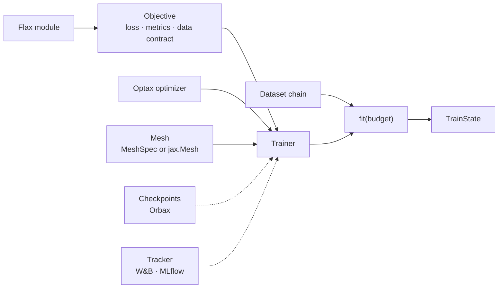
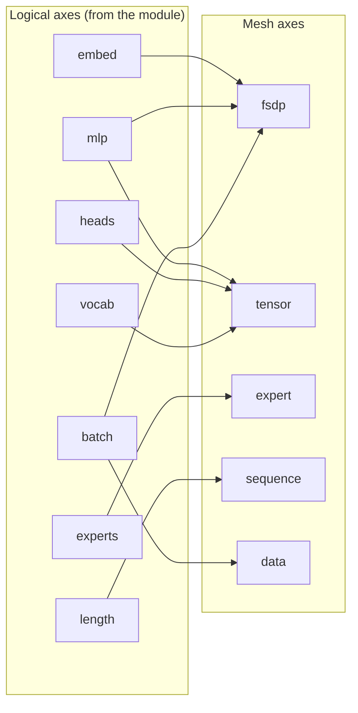

# Training in Dew: an objective, an optimizer, a mesh, and `fit`

Design record, 2026-10-12. This is the binding design for Dew's training and model API. Code blocks show the target API; implementation and qualification work lives in the [roadmap](../roadmap.md). Its data counterpart is [the data design](data.md). Shared code ownership is in [architecture](architecture.md), and behavioral qualification is in [testing](testing.md).

## 0. The idea in one paragraph

A `Trainer` runs an `Objective` (the loss and metrics for one kind of training: language modelling, diffusion, decision, preference, RL) with an Optax optimizer on a device mesh. `fit` takes a data chain and a budget. Everything between (sharding, micro-batches, rematerialization, kernels, compilation, checkpoints, resume) is chosen by Dew from the model, the mesh and the hardware, and every one of those choices can be overridden. The model is a plain Flax module, the optimizer is plain Optax, checkpoints are plain Orbax, and the mesh can be a plain `jax.Mesh`.

```python
model = CausalTransformer(vocab=50_257, width=768, depth=12, heads=12)
trainer = Trainer(LMObjective(model, seq_len=1024), optax.adamw(3e-4), key=0)
state = trainer.fit(train, validation=val, tokens=10e9)
```



## 1. Models

Any Flax module trains. The objective calls the module's forward through Flax's `apply`. Binding a different forward method is tracked in the [roadmap](../roadmap.md#models-and-interop).

```python
class MyLM(nn.Module):
    def __call__(self, tokens, *, positions=None, segment_ids=None): ...

LMObjective(MyLM(...), seq_len=2048)
```

- Flax NNX modules go through Flax's own NNX-to-Linen bridge; Dew has no second module system.
- Variables are whatever Flax returns (plain dicts, or `FrozenDict` from older code). The Trainer normalizes the tree once at its boundary, so training, saving and restoring see one form.
- Pretrained weights come from `Pretrained.load("Qwen/Qwen3.5-0.8B")`, which returns the module, its variables and its processor.

### A context read through cross-attention

A decision (`dew.decision`) may read a context beside its state: `Example.context`, any JSON value, rendered as text by the decision's tokenizer. A context longer than `context_length` tokens is refused, never cut: a request with one raises (ValueError), and a run whose data holds one refuses where its data plan reads that record: before training for data the run reads into memory, when the record is reached for data it streams or indexes. A decision never answers from part of what it was given. The context reaches the cross-attention as `DecisionModel.context_encoder` says, through `dew.nn.cross_attention.encode_context`, which any model with cross-attention layers takes for a context of its own tokens: its tokens through the backbone's own embedding table (`table`, the default), or the backbone's final states over it in a pass of its own (`backbone`, as a schema read in context always is), recorded in the task's settings so a reload reads it the same way. A source takes the gated cross-attention blocks that read it with `Pretrained.with_cross_attention(CrossAttention(layers, context_length), key=...)` (`DecisionRunConfig.context_layers` and `context_length` on the command line). The blocks start with zero gates, so the model computes what the source computes until they train. The variables hold the blocks under `params` and the source's weights under `FROZEN`, so the objective trains the blocks alone (and an adapter's factors, where `lora` adds them), and the source stays as loaded. A multimodal source takes the blocks on its language model and reads a context beside its images.

- **Packing.** Rows that carry a context pack one to a window (`DecisionObjective.bounds`), so each window's context is its row's; the batch holds each row's context tokens and their count (`context_lengths`).
- **Work.** `train/flops` counts the blocks' work over each row's real context tokens (`CrossAttending.cross_flops`): a frozen source's training work, plus three passes of the blocks and the head.
- **Serving.** `Decide(state, questions, context=...)` and `Decide.batch(requests, contexts=...)` read a request's context as training did, its images too.
- **No blocks attached.** Training over a source without cross-attention leaves `Example.context` unread: the rows carry no context, as a table with no context column trains. Serving refuses a context such a task cannot read (ValueError), and a model refuses rows that carry one (TypeError), so no answer silently ignores a context it was given.

### Consistency groups

An example's questions that ask the same thing, one negated, paraphrased or with its options re-ordered, may stand in a group (`Example.groups`, `Group`): each member maps every one of its option keys onto a canonical key the members share, read from a row's `groups` field as `{name: {question: {option: canonical}}}`. `DecisionObjective(consistency=w)` adds w times the mean over a batch's groups of their members' generalized Jensen-Shannon divergence (`dew.nn.categorical.group_divergence`, the categorical owner's, which any objective whose predictions over shared classes should agree may add): each member's answer is its distribution over its option slots summed onto the canonical keys, a "none of the above" that replaced an option standing for it, and the divergence is the mean of each member's KL divergence from the members' mean answer, zero where they agree and at most the log of their count. It is reported as the `consistency` metric; the label loss beside it is unchanged. A group's members stand in one row, so a layout of a question a row refuses a run with a consistency term over examples with groups (ValueError); at w = 0, the default, the groups are not read and every layout takes them. Groups across rows, which need packing that holds a group's rows together, are not yet supported.

### Averaging runs

`Decide.averaged(runs, step=, ema=, calibrate_on=)` is the task over the runs' `dew.checkpoints.averaged` mean, its calibration the identity, refit on `calibrate_on`, as temperatures belong to one set of weights. The runs' recorded task settings (`DecideSettings`) must be the same, else the run is refused (ValueError). Its `Weights.averaged` records each run's directory, step and average read. As no one run holds its weights, `Decide.save(directory)` writes the average to a directory of its own as a run: its calibration, then one checkpoint of the average (its optimizer state empty) under the record its runs share, its model the base an adapter merged into, and its calibration, which `Decide.from_run` and `dew.pipeline` read back for any layout; a directory holding another run's checkpoints is refused.

### Options read at labels

A question layout given `labels=Labels(...)` writes each option as a line `{label}. {text}` (labels `A` to `Z`, then two letters, or a release's own list, `Labels.names`), the whole line its span, and the answer cue (`Labels.cue`) last. The lines share the layout's `head_max_len` with the instructions as marker options do, and in the parallel layout each line starts at the first one's position, none reading another, and the cue reads them all. Over a causal backbone (`TokenModel.causal`) the parallel layout's visibility is causal as well, so no token reads a later one and no option reads another through the tokens after them. Its rows carry each question's answer position (`DecisionInputs.readout`), which packing moves with the row as it moves the spans. A label is read as the token of each of `Labels.variants`, a template of its name (`" {}"` by default; `"{}"` for the bare letter); a variant the tokenizer spells as more than one token is refused (ValueError). Two heads read these rows:

- **`LabelReadout`** is Dew's own readout. Tied, it reads the backbone's own logit at each label of the answer position: the backbone's output table at those columns alone (`OutputTable.columns`, with the table's input QDQ, scale, bias and softcap, its product in fp32 or wider), and where the head is no single table (an adapter, a transform), its exact head over the answer states (`LogitsFromHidden`), the labels' columns taken. Several variants of a label are grouped by their logsumexp. `untied=True` gives each variant a trainable row and bias drawn from its output row and bias, read through the same cap, so at its draw it is the tied readout.
- **`SlotReadout`** is a published slot release's head: slot `i` scores `<slot_i, h> + <q h, k m_i> / sqrt(head_dim)`, `h` the answer state and `m_i` the mean final state over option `i`'s line, with no bias and no softcap. It may hold more slot rows (`slot_rows`) than its labels, as a release's file does.

A readout reads a row's labels only where they are its own, its first as many as the question has options (`Head.validate_rows`, ValueError), and a pass padded past them reads -inf there. Both readouts compute in at least float32, and a run reloaded at another dtype (`Decide.from_run(dtype=)`) widens them.

### A question row written by segments

A question layout given `segments` writes its rows from values rather than its own text (`dew.decision.renderer`, docs/design/decision-render.md): `Text`, the request's `State` (how it renders, `render`, and what a cut keeps of it, `keep`: its start, its end, or all of it), the question's `Instructions` under a header of its kind, its `OptionLines` (each option one line under its label, the line its span), and an `AnswerCue`. `framing` makes the text a conversation's user turn, and `unit` says how the text is encoded:

- `pieces` encodes each piece alone, as a release that encodes its prompt piece by piece does.
- `whole` encodes the turn once, as a release that encodes its whole prompt does, locating each span by the tokenizer's character offsets (`Tokenizer.offsets`; a slow tokenizer keeps none and is refused): a span takes every token that overlaps its characters. The framing renders the turn with its own content through the chat template, which holds it as written or trimmed; a template that rewrites it otherwise is refused.

The rows are read at their last token. A row past `max_len` cuts its state at the state's own token boundaries, re-encoding each candidate whole, to the longest that fits; a state kept whole leaves an overlong row unfit. `blocks=True` splits each row into two blocks (`Encoded.blocks`, `DecisionInputs.blocks`): block 0 is its state and everything before its question, and block 1 its question to the row's end, the tokens that end at or before the question's first character being block 0 (a release's prefix and suffix, serve.patch `block_ids`), and the padding is in no block (-1). A backbone whose attention kinds read blocks (`AttentionMixer.bidirectional_blocks`) attends to each block whole and to the first from the second in order, within each row's document; one that reads none reads the row in order. The blocks ride a batch, a serving pass's widening and a packed window with their row. A marker row, which asks its question before its state, reads what precedes its question as block 0 and the rest as block 1; parallel options set what each token reads themselves, and take no blocks. Off, a row carries no blocks and is read in order exactly as before. A published slot release's prompt is such a value: its system message, a tagged state kept whole, `Question:` or `Rate the state:` over the instructions, lettered option lines under the release's own 256 labels, its cue, framed with thinking off and encoded whole. A row may hold the state more than once, each copy its own render, budget (`State.max_tokens`) and cut rule, sharing the row's room as decision-inputs.md says; the row's `state_kept` and `state_tokens` are its least-kept copy's.

## 2. The mesh

Two ways to describe the devices, one path underneath.

```python
# Convenient: counts per role; the data axis takes the devices left over.
Trainer(objective, opt, key=0, mesh=MeshSpec(fsdp=8, tensor=2))

# Native: your own jax.Mesh, any axis names, and how the model maps onto them.
mesh = jax.make_mesh((4, 8, 2), ("replica", "fsdp", "context"))
Trainer(objective, opt, key=0, mesh=mesh,
        layout=Layout(rules={"embed": "fsdp", "mlp": "fsdp", "length": "context"},
                      data_axes=("replica", "fsdp")))
```

`MeshSpec` builds Dew's six named axes (`data`, `fsdp`, `expert`, `tensor`, `sequence`, `stage`). It is serializable, so a run's `run.json` and the command line (`--mesh.fsdp 8`) can store it and a resumed run rebuilds the mesh on whatever hardware it lands on. Its `replicas=` orders devices for hybrid sharded data parallelism, so FSDP's gathers stay inside a host's NVLink domain and only the gradient all-reduce crosses the slower network.

A native `jax.Mesh` needs two facts from you in `Layout`: `rules`, which map the model's logical axes (`embed`, `mlp`, `heads`, `vocab`, `experts`, `length`, `layers`) onto mesh axes, and `data_axes`, which say which axes split the batch. `data_axes=` is shorthand that writes the one batch rule everything else reads: each host's data share, gradient reduction, and token accounting. Model-parallel algorithms keep their role names: expert exchange runs on an axis called `expert`, sequence attention on `sequence`, pipeline stages on `stage`. Any other axis, a second FSDP level or a context axis, is free for parameters and data through the rules. Dew refuses by name only what cannot work: a rule naming an axis the mesh lacks, or a parameter placed on a data axis.



`microbatches=` for pipeline stages is a Trainer argument (default: one per stage), the same for both mesh forms.

Where the layout splits a leaf, the shared rule table and that leaf's declared logical axes place it; a leaf that declares none falls back to a shape heuristic, and refusing it instead is not built yet. A rule outside Dew's defaults (`DEFAULT_RULES`) that names an axis the mesh lacks is refused, a role axis among them, since it would split nothing; Dew's own rules take a missing role axis as size 1. A placement rule that deviates for one model family is a separate rule (expert parallelism's, tensor parallelism's), never a branch in the default.

On any mesh, the layout reports what it is about to do before the first step, as `Layout.validate(mesh, state)` over the state as it will be placed (`jax.ShapeDtypeStruct`s carrying their shardings, so nothing is allocated): which leaves split over which axes and the part each device holds, the bytes each device keeps between steps (parameters, optimizer state, EMA, and the gradient accumulator where steps pool), the axes a batch's rows split over, the collectives a step runs over each mesh axis by the role the placement gives it (an all-reduce over the batch's axes, an all-gather and a reduce-scatter where a batch axis also splits the state, an all-reduce over a width a tensor axis splits and a collective-permute between stages), and each logical axis the variables declare that no rule names, whose dimension stays whole on every device (a leaf none of whose names a rule places takes the shape heuristic). It refuses a state some device cannot hold, against the capacity the caller states, else the device's own allocator limit (`bytes_limit` in its memory stats); a CPU mesh standing in for GPUs reports none, so its caller states the GPUs'. `fit` validates the state it builds, restores (with the checkpoint's accumulator) or is given before placing it. The accumulator and narrow copies a fresh run's step adds depend on the batch, which `fit` reads after placing, so the plan's fit check counts them for each candidate before any is built (§3), and `Trainer.validation` keeps the report of the plan the run takes. `Trainer.validate(batch, capacity=...)` reads the same state, the accumulator for `batch` included, on a CPU host before a costly launch. A mismatch between the rules and the mesh's axis names fails there, where `Layout.shardings` reads the rules, not in GSPMD. How a mixture's experts meet their tokens over the expert axis (an all-to-all or a gather, by the layer's dispatch) and the attention's exchange over the sequence axis (an all-to-all or a gather, by its heads and lengths) are the model's choices and are not named.

## 3. Memory and speed are chosen for you

Before it places the state it starts from, `fit` refuses a mesh whose devices cannot hold it (`Layout.validate`, §2). The memory planner then picks, per model, mesh and GPU, the cheapest combination that fits: micro-batch size, rematerialization policy and LM-head tiling. Host offload is the layout's (`Layout.host`); choosing it automatically is tracked in the [roadmap](../roadmap.md#training-and-parallelism). The planner checks each candidate against its compiled program's memory analysis. Where none fits, `fit` raises naming the split, rematerialization and head options it tried, and the closest candidate's temporary and argument bytes where the analysis gave them. The same `batch(1024)` works on one GPU or 256. You override any one of them:

```python
Trainer(objective, opt, key=0, accumulation=4)                    # fix the micro-batch split
Trainer(objective, opt, key=0, layout=Layout(host=("optimizer",)))  # keep optimizer state in host memory
```

A state kept in host memory (`Layout(host=("variables",))`) steps on the accelerator through programs compiled under the resident step's own XLA options (`step_compiler_options`: the dot merger, collectives and Triton GEMM choices), so a host step differs from a resident one by the host boundary alone. Every eligible model takes the planner's path: no model family needs a planner of its own. Kernels are chosen per GPU generation from one table (`dew.nn.kernels`): FlashAttention 3 on Hopper, FlashAttention 2 on Ampere and Blackwell workstations, fla's gated delta rule, fused norms and SwiGLU. A kernel replaces the XLA path only when it is measured faster and passes the float64 accuracy gate on that GPU. Tile sizes come from one autotuner per GPU and shape, cached with XLA's own autotune results.

## 4. `fit`

```python
state = trainer.fit(
    train,                                    # a Dataset chain, a Grain dataset, or arrays
    validation={"web": val_web, "code": val_code},
    tokens=50e9,                              # or steps= or epochs=
    eval_every=1000,
    checkpoint_every=datetime.timedelta(minutes=30),
    best="validation/web/loss", restore_best=True,
    stop=Plateau(patience=5),
)
```

- One budget: `steps=`, `epochs=` or `tokens=` (committed valid target tokens, the same clock the data `schedule` reads). A run's tokens grow only at a committed update. `fit` checks the budget between steps, so after a rejected microbatch a split step can reach it at a commit and keep a later partial window; ending at that commit is not built yet.
- `validation` is one chain or a dict of named chains, each reported separately.
- `fit` returns the final `TrainState`. `state=` supplies initial state rather than a continuation; checkpoint restore also restores the data position.
- An update moves the weights as Optax applies it, and then by each post-step effect the optimizer's state holds for that update, in the chain's order: MuonClip's rescale of the query and key kernels, one rounding of `gamma * (W + update)` as the paper and Megatron Core write it, and a bounded param group's exact clamp, as torch recipes clamp after `optimizer.step()`. `dew.optim.stepped(params, updates, before, after)` forms them, from the optimizer's state before and after the update; the trainer's step and `power_profiles` call it, and so does a loop of your own. A transform the update did not run, a group a mask left out or an update `optax.MultiSteps` or `optax.apply_if_finite` deferred or rejected, returns its state as it was, and its effect is left out.
- A configured rate is its schedule's own: the solver holds the schedule's rate-valued fields as operands and builds Optax's schedule of them at each update (`dew.optim.scheduled_solver`), so a run's rate rounds as Optax's does and runs at other rates of one schedule's timings share one executable.

### The batch contract

A data mismatch fails within seconds of launch, on every host at once, never hours into a run.

1. The data chain declares what it yields: each stream's fields, per-row shapes and dtypes, with the batch sharding from the mesh. This is MaxText's `get_shaped_batch`, the producer's shape. It is known before any read where the chain fixes it (presets, `pack`, buckets, `batch`); a chain with your own `map`s takes it from its first batch.
2. The step compiles from those shapes, `jit(step).lower(abstract_state, abstract_batch).compile()`, while the readers open. A `schedule` gives one shape per stage. The readers' shapes are compared with what the run already declares it reads, with no new declaration: `InputSpec`'s sample and mask, each condition encoder's token length, a supervised model's input shape, the model's vocabulary for id fields, and the host-only fields a metric names (such as the captions a CLIP score compares). Lowering then catches any other missing field. A wrong image size is caught here, because a convolution would trace at the wrong size without complaint.
3. Each host reads only its share and checks it as numpy, before `jax.make_array_from_process_local_data` turns it into a global array: field names, per-row shapes, dtypes, the share's row count, and the bounds an id field declares (a gather past the vocabulary would clamp silently on the device). At start, `fit` reads the first batch of the training stream and of every validation stream while it initializes, restores and compiles. These checks run inside `agreed()`, so all hosts report every mismatch in every stream in one error before step 1. The batches it read are used, not read again. `objective.check(batch)` runs the same path on a laptop before a costly launch.
4. Later batches take the same local comparison before transfer, with no collective. Shapes are fixed by construction (presets, `pack`, `batch` without a partial last batch), so a mismatch means a step broke one: the host raises naming the step and records, and JAX's coordination service stops the others. A `schedule` stage's new shape is expected and compiled once.

## 5. Checkpoints and resume

```python
Trainer(objective, opt, key=0,
        checkpoints=Checkpoints("gs://runs/lm-1b", keep=Keep(latest=2, every=10_000)))
```

- A run with a checkpoint directory resumes automatically from its latest checkpoint: parameters, optimizer state, step, RNG and each data share's position. Resume is exact on the same mesh.
- A checkpoint directory belongs to one run. A fresh run takes a new directory; a directory holding another run's checkpoints refuses to resume, naming what differs.
- A resumed run skips loading pretrained weights it is about to overwrite, and its first step hits the compile cache.
- A resumed `OptimConfig` run steps at the rate it configures, not the checkpoint's: its schedule's rate fields are set over the restored state (`dew.optim.with_rates`). An optimizer state written before Dew held those fields, its rate a scale times a schedule's shape, is refused by name.
- `Keep` decides retention; `where=` sees each checkpoint's real record (kind, step, metrics).
- The directory is a plain Orbax `CheckpointManager` directory, readable without Dew.
- `dew.checkpoints.averaged(runs, step=, ema=)` averages runs trained apart from one start, any objective's: each run's model tree as its loaders read it (its average where it keeps one, unless `ema=False`), in fp32, its frozen leaves back in `params` and a LoRA run's factors merged into their kernels first, so a LoRA run, a partly frozen one and a whole fine-tune of one base average. The mean is elementwise, so each process takes it over the shards it holds of the runs read onto `mesh` and `layout`, a replicated block once, on the host, one run's shards beside it at a time, and a pool averages runs no one process holds whole: each floating leaf a running mean that cannot overflow, float64's mean rounded once for two runs, subnormals included, and on par with a stacked fp32 mean for more; an integer or boolean leaf must agree. Runs of another model record (adapters aside) or other leaves are refused; where each run started is the caller's to know. The result carries the mean, placed as the first run's leaves are, the model record it applies to and each run's directory, step and average read.

## 6. Compilation

Compiled programs depend only on the model, shapes, dtypes, shardings and configuration, never on where a run happens to be: a compiled program captures no run path, temporary directory or checkout location. The persistent compile cache is shared across runs, processes and checkouts. A resumed or repeated run reuses its programs. `lower_for=` lowers a step for a GPU generation on any host. Compiling that lowered step before a GPU is held and carrying its executable into the run is tracked in the [roadmap](../roadmap.md#training-and-parallelism).

## 7. Seeing what happens

Every run logs canonical MFU (analytic model FLOPs on real tokens over wall time) and where step time goes. A model reports its FLOPs through `model_flops`; a model without them reports no MFU rather than an estimate. Each kernel dispatch records which kernel it chose and why (`dew.nn.kernels.generation.routes`); collecting those choices into a run's report is not built yet. Trackers (W&B, MLflow) take the same metrics; the local metric journal is JSONL. The [roadmap](../roadmap.md#kernels-and-performance) tracks a `dew profile` command that reports the step breakdown, chosen kernels and top three losses from the existing attribution tools.

## 8. After training

```python
pipe = dew.pipeline("runs/lm-1b")                 # the trained model with its processor
pipe("The capital of France is", max_new_tokens=32, key=0)
pipe([{"role": "user", "content": "Hi"}], key=1)  # chat, no PyTorch needed

Pretrained.from_run("runs/lm-1b").save("out/")     # loads in transformers and vLLM
adapter.save("out/lora")                          # a complete PEFT adapter
```

A reloaded run behaves like the live one: the same processor, chat template and generation defaults.

## 9. The shared seams, as a user sees them

| Seam | What it guarantees |
|---|---|
| Token coordinates | Packed, padded and cached rows give the same result as separate ones, in every mixer (attention, GDN, KDA, Mamba). |
| Layer identity | Quantization survives fused projections, scanned layers and pipeline stages. |
| One LM head | Full logits, the chunked loss and scoring compute the head the same way, quantized or not, sharded or not. |
| Loading readers | Every model family loads and exports through one reversible weight-layout plan. |
| Checkpoint state | Saving and restoring derive from the training state's own schema; restore casts and places once. |

Each seam requires one standing end-to-end test that runs every implementation registered for it. The [roadmap](../roadmap.md#ci-and-tooling) tracks the registry-wide coverage still to add.

## 10. Examples

### LoRA fine-tuning a chat model, exported for vLLM

```python
bundle = Pretrained.load("Qwen/Qwen3.5-0.8B")
adapted, adapter = bundle.adapt(LoRA(rank=16), key=0)
chats = Hub("HuggingFaceH4/ultrachat_200k", split="train_sft").map(chat.template(bundle.processor)).pack(seq_len=4096)
trainer = Trainer(LMObjective(adapted, seq_len=4096, loss_role=Role.ASSISTANT), optax.adamw(1e-4), key=0)
trainer.fit(chats.shuffle(seed=0).batch(64), epochs=2)
adapter.save("out/lora")
```

### A diffusion model, then samples

```python
model = DiT.preset("dit-b/2")
data = Files("gs://data/laion/*.array_record").filter_map(images.DecodeImage()).map(images.Resize(256)).batch(256)
trainer = Trainer(DiffusionObjective(model, process=FlowMatching(), vae="stabilityai/sd-vae-ft-ema"), optax.adamw(1e-4), key=0)
state = trainer.fit(data, steps=400_000)
images = dew.pipeline(trainer)("a red fox in snow", steps=50, guidance=4.0, key=0)
```

### The same LM script on 64 GPUs

```python
trainer = Trainer(LMObjective(model, seq_len=8192), optax.adamw(3e-4), key=0,
                  mesh=MeshSpec(fsdp=8, replicas=8),
                  checkpoints=Checkpoints("gs://runs/lm-8b"))
trainer.fit(data, tokens=2e12)    # launched on every host with `dew launch`
```

