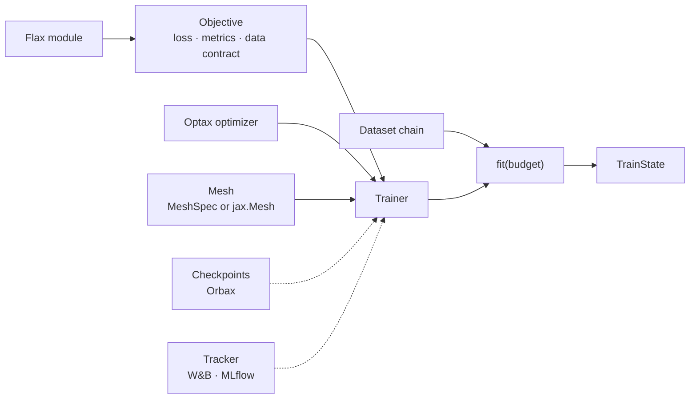
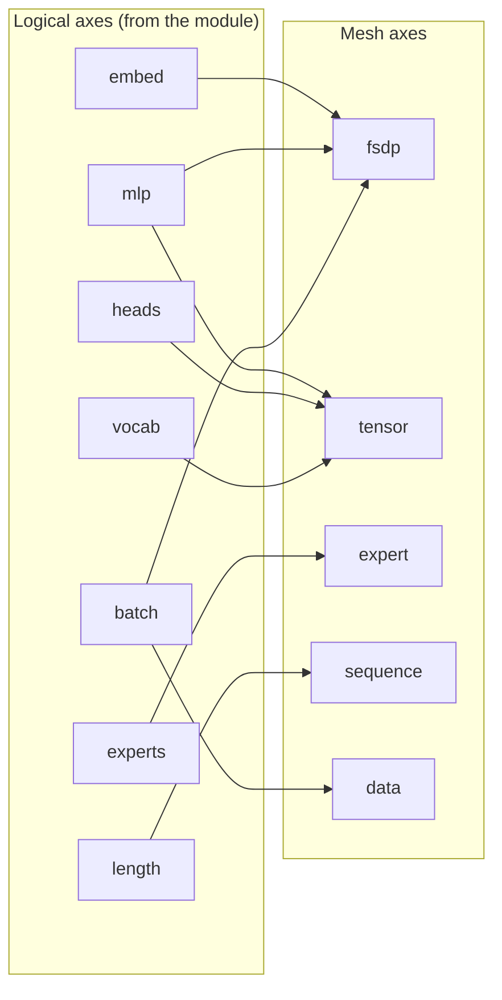

# Training in Dew: an objective, an optimizer, a mesh, and `fit`

Design record, 2026-10-12. This is the binding design for Dew's training and model API. Code blocks show the target API; implementation and qualification work lives in the [roadmap](../roadmap.md). Its data counterpart is [the data design](data.md). Shared code ownership is in [architecture](architecture.md), and behavioral qualification is in [testing](testing.md).

## 0. The idea in one paragraph

A `Trainer` runs an `Objective` (the loss and metrics for one kind of training: language modelling, diffusion, decision, preference, RL) with an Optax optimizer on a device mesh. `fit` takes a data chain and a budget. Everything between (sharding, micro-batches, rematerialization, kernels, compilation, checkpoints, resume) is chosen by Dew from the model, the mesh and the hardware, and every one of those choices can be overridden. The model is a plain Flax module, the optimizer is plain Optax, checkpoints are plain Orbax, and the mesh can be a plain `jax.Mesh`.

```python
model = CausalTransformer(vocab=50_257, width=768, depth=12, heads=12)
trainer = Trainer(LMObjective(model, seq_len=1024), optax.adamw(3e-4), key=0)
state = trainer.fit(train, validation=val, tokens=10e9)
```



## 1. Models

Any Flax module trains. The objective calls the module's forward through Flax's `apply`. Binding a different forward method is tracked in the [roadmap](../roadmap.md#models-and-interop).

```python
class MyLM(nn.Module):
    def __call__(self, tokens, *, positions=None, segment_ids=None): ...

LMObjective(MyLM(...), seq_len=2048)
```

- Flax NNX modules go through Flax's own NNX-to-Linen bridge; Dew has no second module system.
- Variables are whatever Flax returns (plain dicts, or `FrozenDict` from older code or a loaded task). The trees an objective holds and the collections its loss writes back are plain dicts (`dew.batch.dicts`), and the Trainer normalizes its state once at its boundary, so placement, training, saving and restoring see one form.
- Pretrained weights come from `Pretrained.load("Qwen/Qwen3.5-0.8B")`, which returns the module, its variables and its processor.

### A context read through cross-attention

A decision (`dew.decision`) may read a context beside its state: `Example.context`, any JSON value, rendered as text by the decision's tokenizer. A context longer than `context_length` tokens is refused, never cut: a request with one raises (ValueError), and a run whose data holds one refuses where its data plan reads that record: before training for data the run reads into memory, when the record is reached for data it streams or indexes. A decision never answers from part of what it was given. The context reaches the cross-attention as `DecisionModel.context_encoder` says, through `dew.nn.cross_attention.encode_context`, which any model with cross-attention layers takes for a context of its own tokens: its tokens through the backbone's own embedding table (`table`, the default), or the backbone's final states over it in a pass of its own (`backbone`, as a schema read in context always is), recorded in the task's settings so a reload reads it the same way. A source takes the gated cross-attention blocks that read it with `Pretrained.with_cross_attention(CrossAttention(layers, context_length), key=...)` (`DecisionRunConfig.context_layers` and `context_length` on the command line). The blocks start with zero gates, so the model computes what the source computes until they train. The variables hold the blocks under `params` and the source's weights under `FROZEN`, so the objective trains the blocks alone (and an adapter's factors, where `lora` adds them), and the source stays as loaded; with `frozen=False` (`--no-context-frozen`) the blocks freeze nothing more: the source's weights stay as its own split holds them, so an unsplit source trains whole beside the blocks, a full fine-tune, with the context's own pass trained too where the backbone encodes it, and a LoRA adapter, attached before or after, trains its factors and the blocks over its frozen base. A context holds as many tokens as `context_length` says, as long as its encoder reads. A multimodal source takes the blocks on its language model and reads a context beside its images.

- **Packing.** Rows that carry a context pack as any rows do, several to a window. Each row's context lies end to end along the window's context in the order its rows stand, numbered as its row (`context_segments`, 0 for padding), so each row reads its own context and no other row's. A window counts its rows, questions and context tokens as distinct units (`DecisionObjective.bounds`).
- **Work.** `train/flops` counts the blocks' work over each row's real context tokens (`CrossAttending.cross_flops`): a frozen source's training work, plus three passes of the blocks and the head.
- **Serving.** `Decide(state, questions, context=...)` and `Decide.batch(requests, contexts=...)` read a request's context as training did, its images too.
- **No blocks attached.** Training over a source without cross-attention leaves `Example.context` unread: the rows carry no context, as a table with no context column trains. Serving refuses a context such a task cannot read (ValueError), and a model refuses rows that carry one (TypeError), so no answer silently ignores a context it was given.

### Consistency groups

An example's questions that ask the same thing, one negated, paraphrased or with its options re-ordered, may stand in a group (`Example.groups`, `Group`): each member maps every one of its option keys onto a canonical key the members share, read from a row's `groups` field as `{name: {question: {option: canonical}}}`. `DecisionObjective(consistency=w)` adds w times the mean over a batch's groups of their members' generalized Jensen-Shannon divergence (`dew.nn.categorical.group_divergence`, the categorical owner's, which any objective whose predictions over shared classes should agree may add): each member's answer is its distribution over its option slots summed onto the canonical keys, a "none of the above" that replaced an option standing for it, and the divergence is the mean of each member's KL divergence from the members' mean answer, zero where they agree and at most the log of their count. It is reported as the `consistency` metric; the label loss beside it is unchanged. Questions asked in rows of their own, the same question about a reworded state, paraphrased or negated, stand in one group across examples (`GroupedExamples`: its examples and its groups, each member named `"<example index>.<question>"`, read from a row's `examples` and `groups` fields), and an example's own groups under a layout of a question a row stand in rows of their own too. Such rows train as one unit: the packer places the unit's rows whole in one window, and the window numbers each unit's groups apart, so the term reads a group's members wherever its rows stand. A group is optional, and it never costs an example that fits on its own. A unit that no window holds (its tokens, rows or questions past the window's), or one with an example that fits no row, trains its examples apart, each as it trains alone; the unit's consistency term is the only thing lost (`Fit._unit`). At w = 0, the default, the groups are not read.

### Averaging runs

`Decide.averaged(runs, step=, ema=, calibrate_on=)` is the task over the runs' `dew.checkpoints.averaged` mean, its calibration the identity, refit on `calibrate_on`, as temperatures belong to one set of weights. The runs' recorded task settings (`DecideSettings`) must be the same, else the run is refused (ValueError). Its `Weights.averaged` records each run's directory, step and average read. As no one run holds its weights, `Decide.save(directory)` writes the average to a directory of its own as a run: its calibration, then one checkpoint of the average (its optimizer state empty) under the record its runs share, its model the base an adapter merged into, and its calibration, which `Decide.from_run` and `dew.pipeline` read back for any layout; a directory holding another run's checkpoints is refused.

### Options read at labels

A question layout given `labels=Labels(...)` writes each option as a line `{label}. {text}` (labels `A` to `Z`, then two letters, or a release's own list, `Labels.names`), the whole line its span, and the answer cue (`Labels.cue`) last. The lines share the layout's `head_max_len` with the instructions as marker options do, and in the parallel layout each line starts at the first one's position, none reading another, and the cue reads them all. Over a causal backbone (`TokenModel.causal`) the parallel layout's visibility is causal as well, so no token reads a later one and no option reads another through the tokens after them. Its rows carry each question's answer position (`DecisionInputs.readout`), which packing moves with the row as it moves the spans. A label is read as the token of each of `Labels.variants`, a template of its name (`" {}"` by default; `"{}"` for the bare letter); a variant the tokenizer spells as more than one token is refused (ValueError). Two heads read these rows:

- **`LabelReadout`** is Dew's own readout. Tied, it reads the backbone's own logit at each label of the answer position: the backbone's output table at those columns alone (`OutputTable.columns`, with the table's input QDQ, scale, bias and softcap, its product in fp32 or wider), and where the head is no single table (an adapter, a transform), its exact head over the answer states (`LogitsFromHidden`), the labels' columns taken. Several variants of a label are grouped by their logsumexp. `untied=True` gives each variant a trainable row and bias drawn from its output row and bias, read through the same cap, so at its draw it is the tied readout.
- **`SlotReadout`** is a published slot release's head: slot `i` scores `<slot_i, h> + <q h, k m_i> / sqrt(head_dim)`, `h` the answer state and `m_i` the mean final state over option `i`'s line, with no bias and no softcap. It may hold more slot rows (`slot_rows`) than its labels, as a release's file does.

A readout reads a row's labels only where they are its own, its first as many as the question has options (`Head.validate_rows`, ValueError), and a pass padded past them reads -inf there. Both readouts compute in at least float32, and a run reloaded at another dtype (`Decide.from_run(dtype=)`) widens them.

### A question row written by segments

A question layout given `segments` writes its rows from values rather than its own text (`dew.decision.renderer`, docs/design/decision-render.md): `Text`, the request's `State` (how it renders, `render`, and what a cut keeps of it, `keep`: its start, its end, or all of it), the question's `Instructions` under a header of its kind, its `OptionLines` (each option one line under its label, the line its span), and an `AnswerCue`. `framing` makes the text a conversation's user turn, and `unit` says how the text is encoded:

- `pieces` encodes each piece alone, as a release that encodes its prompt piece by piece does.
- `whole` encodes the turn once, as a release that encodes its whole prompt does, locating each span by the tokenizer's character offsets (`Tokenizer.offsets`; a slow tokenizer keeps none and is refused): a span takes every token that overlaps its characters. The framing renders the turn with its own content through the chat template, which holds it as written or trimmed; a template that rewrites it otherwise is refused.

The rows are read at their last token. A row past `max_len` cuts its state at the state's own token boundaries, re-encoding each candidate whole, to the longest that fits; a state kept whole leaves an overlong row unfit. `blocks=True` splits each row into two blocks (`Encoded.blocks`, `DecisionInputs.blocks`) where its second part begins, as its segments order them (`QuestionLayout.segments`, a run's `segments`). A row whose state comes first has its state and everything before its question as block 0. Block 1 is its question from its header to the row's end, and the tokens that end at or before the question's first character are block 0 (a release's prefix and suffix, serve.patch `block_ids`). A row whose question comes first has its question and everything before its state as block 0, and block 1 is its state from its first character to the row's end. A row with no state splits at its question. The padding is in no block (-1). A backbone whose attention kinds read blocks (`AttentionMixer.bidirectional_blocks`) attends to each block whole and to the first from the second in order, within each row's document; one that reads none reads the row in order. The blocks ride a batch, a serving pass's widening and a packed window with their row. A marker row, which asks its question before its state, reads what precedes its question as block 0 and the rest as block 1; parallel options set what each token reads themselves, and take no blocks. Off, a row carries no blocks and is read in order exactly as before. A published slot release's prompt is such a value: its system message, a tagged state kept whole, `Question:` or `Rate the state:` over the instructions, lettered option lines under the release's own 256 labels, its cue, framed with thinking off and encoded whole. A row may hold the state more than once, each copy its own render, budget (`State.max_tokens`) and cut rule, sharing the row's room as decision-inputs.md says; the row's `state_kept` and `state_tokens` are its least-kept copy's.

## 2. The mesh

Two ways to describe the devices, one path underneath.

```python
# Convenient: counts per role; the data axis takes the devices left over.
Trainer(objective, opt, key=0, mesh=MeshSpec(fsdp=8, tensor=2))

# Native: your own jax.Mesh, any axis names, and how the model maps onto them.
mesh = jax.make_mesh((4, 8, 2), ("replica", "fsdp", "context"))
Trainer(objective, opt, key=0, mesh=mesh,
        layout=Layout(rules={"embed": "fsdp", "mlp": "fsdp", "length": "context"},
                      data_axes=("replica", "fsdp")))
```

`MeshSpec` builds Dew's six named axes (`data`, `fsdp`, `expert`, `tensor`, `sequence`, `stage`). It is serializable, so a run's `run.json` and the command line (`--mesh.fsdp 8`) can store it and a resumed run rebuilds the mesh on whatever hardware it lands on. Its `replicas=` orders devices for hybrid sharded data parallelism, so FSDP's gathers stay inside a host's NVLink domain and only the gradient all-reduce crosses the slower network.

A native `jax.Mesh` needs two facts from you in `Layout`: `rules`, which map the model's logical axes (`embed`, `mlp`, `heads`, `vocab`, `experts`, `length`, `layers`) onto mesh axes, and `data_axes`, which say which axes split the batch. `data_axes=` is shorthand that writes the one batch rule everything else reads: each host's data share, gradient reduction, and token accounting. Model-parallel algorithms keep their role names: expert exchange runs on an axis called `expert`, sequence attention on `sequence`, pipeline stages on `stage`. Any other axis, a second FSDP level or a context axis, is free for parameters and data through the rules. Dew refuses by name only what cannot work: a rule naming an axis the mesh lacks, or a parameter placed on a data axis.



`microbatches=` for pipeline stages is a Trainer argument (default: one per stage), the same for both mesh forms.

Where the layout splits a leaf, the shared rule table and that leaf's declared logical axes place it; a leaf that declares none falls back to a shape heuristic, and refusing it instead is not built yet. A rule outside Dew's defaults (`DEFAULT_RULES`) that names an axis the mesh lacks is refused, a role axis among them, since it would split nothing; Dew's own rules take a missing role axis as size 1. A placement rule that deviates for one model family is a separate rule (expert parallelism's, tensor parallelism's), never a branch in the default.

On any mesh, the layout reports what it is about to do before the first step, as `Layout.validate(mesh, state)` over the state as it will be placed (`jax.ShapeDtypeStruct`s carrying their shardings, so nothing is allocated): which leaves split over which axes and the part each device holds, the bytes each device keeps between steps (parameters, optimizer state, EMA, and the gradient accumulator where steps pool), the axes a batch's rows split over, the collectives a step runs over each mesh axis by the role the placement gives it (an all-reduce over the batch's axes, an all-gather and a reduce-scatter where a batch axis or the sequence axis also splits the state, an all-reduce over a width a tensor axis splits and a collective-permute between stages), and each logical axis the variables declare that no rule names, whose dimension stays whole on every device (a leaf none of whose names a rule places takes the shape heuristic). It refuses a state some device cannot hold, against the capacity the caller states, else the device's own allocator limit (`bytes_limit` in its memory stats); a CPU mesh standing in for GPUs reports none, so its caller states the GPUs'. `fit` validates the state it builds, restores (with the checkpoint's accumulator) or is given before placing it. The accumulator and narrow copies a fresh run's step adds depend on the batch, so `fit` reads its first batch on the host before it places anything and refuses a whole state that no split its plan may take holds; once placed, the plan's fit check counts them for each candidate before any is built (§3), and `Trainer.validation` keeps the report of the plan the run takes. `Trainer.validate(batch, capacity=...)` reads the same state, the accumulator for `batch` included, on a CPU host before a costly launch. A mismatch between the rules and the mesh's axis names fails there, where `Layout.shardings` reads the rules, not in GSPMD. How a mixture's experts meet their tokens over the expert axis (an all-to-all or a gather, by the layer's dispatch) and the attention's exchange over the sequence axis (an all-to-all or a gather, by its heads and lengths) are the model's choices and are not named.

## 3. Memory and speed are chosen for you

Before it places the state it starts from, `fit` refuses a mesh whose devices cannot hold it (`Layout.validate`, §2). The memory planner then picks, per model, mesh and GPU, the cheapest combination that fits: micro-batch size, rematerialization policy and LM-head tiling. The ladder holds no host offload. XLA:GPU holds the optimizer state and the EMA whole on the device for the update wherever they rest between steps, so keeping them in host memory frees nothing at a step's peak (a decoder's step on an A100 peaked at 8.427 GB either way). A run keeps them there by its layout (`Layout.host`), which saves only the device memory they would take between steps; the step reads them past its gradient, so the forward and backward run without them. A remat policy that keeps its residuals in pinned host memory (`minimal_offloaded`) keeps as many on the device as `full` does, so it fits nowhere `full` does not; a run takes it by its own remat, and timing it against `full` is tracked in the roadmap. Parameter offload is the layout's too, and choosing it automatically is tracked in the [roadmap](../roadmap.md#training-and-parallelism). The planner checks each candidate against its compiled program's memory analysis. Where none fits, `fit` raises naming the split, rematerialization and head options it tried, and the closest candidate's temporary and argument bytes where the analysis gave them. The same `batch(1024)` works on one GPU or 256. You override any one of them:

```python
Trainer(objective, opt, key=0, accumulation=4)                    # fix the micro-batch split
Trainer(objective, opt, key=0, layout=Layout(host=("optimizer",)))  # keep optimizer state in host memory
```

A state kept in host memory (`Layout(host=("variables",))`) steps on the accelerator through programs compiled under the resident step's own XLA options (`step_compiler_options`: the dot merger, collectives and Triton GEMM choices), so a host step differs from a resident one by the host boundary alone. Every eligible model takes the planner's path: no model family needs a planner of its own. Kernels are chosen per GPU generation from one table (`dew.nn.kernels`): FlashAttention 3 on Hopper, FlashAttention 2 on Ampere and Blackwell workstations, fla's gated delta rule, fused norms and SwiGLU. A kernel replaces the XLA path only when it is measured faster and passes the float64 accuracy gate on that GPU. Tile sizes come from one autotuner per GPU and shape, cached with XLA's own autotune results.

## 4. `fit`

```python
state = trainer.fit(
    train,                                    # a Dataset chain, a Grain dataset, or arrays
    validation={"web": val_web, "code": val_code},
    tokens=50e9,                              # or steps= or epochs=
    eval_every=1000,
    checkpoint_every=datetime.timedelta(minutes=30),
    best="validation/web/loss", restore_best=True,
    stop=Plateau(patience=5),
)
```

- One budget: `steps=`, `epochs=`, `examples=` or `tokens=` (committed valid target tokens, the same clock the data `schedule` reads). A run's tokens grow only at a committed update. `fit` checks the budget between steps, so after a rejected microbatch a split step can reach it at a commit and keep a later partial window; ending at that commit is not built yet. The loop reads the count off the devices only where the steps since its last read could have brought it to the next count it reads (the budget, a pause, a cadence of tokens or a schedule's stage end): a step commits at most its rows' tokens (`Objective.row_tokens`, an LM row's targets), so the steps between dispatch without waiting on the one before. An objective whose rows declare none is read at every step while a count lies ahead.
- `examples=N` trains on the run's first N source examples, each read once with every row it makes. The source examples are the records the chain makes in its own order, its shuffle and mixture included, before any objective step makes several rows of one (a decision layout's row a question). The bound applies there, so it counts examples whatever rows a layout makes of them; an objective's expansion runs after the chain's record order. Where nothing expands, the source examples are the records as they reach the chain's packing, or its batch where nothing packs: the chain reads on past its end where they span passes, its last batch is kept short and marked, and the run takes the steps the data plan counts for them, which size the schedule as `steps=` does. A global order's plan counts them ahead; an order read in its own share, as a pack that runs as rows arrive makes, is counted by one pass over the bounded stream. The steps must make whole updates, and the run is one process's: a pool's processes would split the short batch unevenly and end at steps of their own, which is not built yet.
- `stop=` ends a run before its budget: `Plateau` when validation stops improving, `Pause(fraction)` at that fraction of the budget, between its first update and its end. A pause writes the whole state and the data position, and the budget still sizes the schedule, so the run resumed without the pause trains on as one that never paused.
- `cooldowns=Cooldowns(at, length, shape)` branches the run into cooldowns (Hägele et al. 2024): at each point, a step or a share of the run resolved as a cadence is, the run trains `length` more steps (or a share of the steps so far) on its own batches from where it stands, through its own compiled step, at the learning rates its optimizer's state holds times a decay from 1 to 0 (`1-sqrt` or `linear`; `dew.optim.scaled_rates`, an `OptimConfig`'s solvers' or an injected constant's). Meanwhile the run's moving state waits on the host and its stream is closed, so the devices hold one state and one prefetcher as the run's plan sized them. Every validation suite scores the branch as `cooldown_<split>/<metric>` at the step it branched from; the branch is then discarded, the run's state put back and its stream reopened at its position, before that step's save, so the run's state and keys go on as a run's with no cooldown. A rollout run's branch calls its rollout on the branch's own states at the run's keys, inside the rollout's `branch(name)` where it has one, `name` the branch's own (`cooldown-<step>`, which a resume that runs the branch again names it too). A `RolloutScheduler`'s (and `PPORollout`'s, through its scheduler) draws under that name, so an episode journal keeps the branch's cohorts and episode identities apart from the run's at the same steps and keys (`Snapshot.branch`, `EpisodeId.branch`); it also keeps the branch's records from its log and leaves the run's metrics as they were. An asynchronous acquisition cancels the rollouts in flight as the branch's stream opens, since the branch's weights would finish the run's, and again as the branch ends. The run's acquisition then starts its submissions anew from its position, rather than taking back the draws it had in flight, so an asynchronous run after a branch is the same run's at its state and keys, not its draws bit for bit. A branch at the run's last step runs after that step's final validation and save. A preemption inside a branch stops the run at its step with the branch pending beside its checkpoints as it was resolved (`Checkpoints.cooldown`, the step's own checkpoint left as it is, the pool agreeing the record), and the resume from that step runs it first, at the last step after the final save; a branch whose data runs out records no score. A linear cooldown from a constant rate is the run whose `Linear` decay begins there. A branch counts its own committed tokens from the run's, so a schedule's stage it trains across ends at the step whose commit reaches its tokens, as the run's would, the run's own stage starts kept. A run with no validation, an optimizer state holding no rate a branch can scale (none, or one Optax computes from a step count at each update), and a point inside an update are refused before it trains. The points share one length and decay, so points due at one step are one branch.
- A finite stream that runs out ends the run as its budget would, with its final checkpoint and a completed outcome, on every host at the same step; a stream that runs out on some hosts and not the others is refused on all of them.
- `validation` is one chain or a dict of named chains, each reported separately.
- Data handed as it is steps as given, never batched again: a Grain dataset's elements are the run's batches (batch it with Grain's `.batch`; a map dataset trains endlessly), and a mapping of NumPy arrays is one batch every step, a full-batch run. Each host keeps its share of each batch's rows. A run of minibatches over arrays states them as a chain, `Memory(arrays).batch(size)`, and `examples=` counts a chain's source examples, which handed data has none of.
- `fit` returns the final `TrainState`. `state=` supplies initial state rather than a continuation; checkpoint restore also restores the data position.
- An update moves the weights as Optax applies it, and then by each post-step effect the optimizer's state holds for that update, in the chain's order: MuonClip's rescale of the query and key kernels, one rounding of `gamma * (W + update)` as the paper and Megatron Core write it, and a bounded param group's exact clamp, as torch recipes clamp after `optimizer.step()`. `dew.optim.stepped(params, updates, before, after)` forms them, from the optimizer's state before and after the update; the trainer's step and `power_profiles` call it, and so does a loop of your own. A transform the update did not run, a group a mask left out or an update `optax.MultiSteps` or `optax.apply_if_finite` deferred or rejected, returns its state as it was, and its effect is left out.
- A configured rate is its schedule's own: the solver holds the schedule's rate-valued fields as operands and builds Optax's schedule of them at each update (`dew.optim.scheduled_solver`), so a run's rate rounds as Optax's does and runs at other rates of one schedule's timings share one executable.

### The batch contract

A data mismatch fails within seconds of launch, on every host at once, never hours into a run.

1. The data chain declares what it yields: each stream's fields, per-row shapes and dtypes, with the batch sharding from the mesh. This is MaxText's `get_shaped_batch`, the producer's shape. It is known before any read where the chain fixes it (presets, `pack`, buckets, `batch`); a chain with your own `map`s takes it from its first batch.
2. The step compiles from those shapes, `jit(step).lower(abstract_state, abstract_batch).compile()`, while the readers open. A `schedule` gives one shape per stage. The readers' shapes are compared with what the run already declares it reads, with no new declaration: `InputSpec`'s sample and mask, each condition encoder's token length, a supervised model's input shape, the model's vocabulary for id fields, and the host-only fields a metric names (such as the captions a CLIP score compares). Lowering then catches any other missing field. A wrong image size is caught here, because a convolution would trace at the wrong size without complaint.
3. Each host reads only its share and checks it as numpy, before `jax.make_array_from_process_local_data` turns it into a global array: field names, per-row shapes, dtypes, the share's row count, and the bounds an id field declares (a gather past the vocabulary would clamp silently on the device). At start, `fit` reads the first batch of the training stream and of every validation stream while it initializes, restores and compiles, and checks each against what the objective declares (`InputSpec`), as it checks every batch of a shape it has not seen since. These checks run inside `agreed()`, so all hosts report every mismatch in one error before step 1. The training batch it read is used, not read again; a validation split, which reads in a fixed order, reads its first batch again where it is scored. `objective.check(batch)` runs the same path on a laptop before a costly launch.
4. Later batches take the same local comparison before transfer, with no collective. Shapes are fixed by construction (presets, `pack`, `batch` without a partial last batch), so a mismatch means a step broke one: the host raises naming the step and records, and JAX's coordination service stops the others. A `schedule` stage's new shape is expected and compiled once.

## 5. Checkpoints and resume

```python
Trainer(objective, opt, key=0,
        checkpoints=Checkpoints("gs://runs/lm-1b", keep=Keep(latest=2, every=10_000)))
```

- A run with a checkpoint directory resumes automatically from its latest checkpoint: parameters, optimizer state, step, RNG and each data share's position. Resume is exact on the same mesh. `fit(resume=)` makes the choice explicit: `"require"` refuses a directory with nothing to continue, for a job that must not silently start fresh, and `"never"` refuses one that already holds a run (`Checkpoints.resumed`); a run configuration takes it as `trainer.resume` and refuses before its record is written.
- A checkpoint directory belongs to one run. A fresh run takes a new directory; a directory holding another run's checkpoints refuses to resume, naming what differs.
- A resumed run skips loading pretrained weights it is about to overwrite, and its first step hits the compile cache.
- A resumed `OptimConfig` run steps at the rate it configures, not the checkpoint's: its schedule's rate fields are set over the restored state (`dew.optim.with_rates`). An optimizer state written before Dew held those fields, its rate a scale times a schedule's shape, is refused by name.
- `Keep` decides retention; `where=` sees each checkpoint's real record (kind, step, metrics).
- The directory is a plain Orbax `CheckpointManager` directory, readable without Dew.
- `dew.checkpoints.averaged(runs, step=, ema=)` averages runs trained apart from one start, any objective's: each run's model tree as its loaders read it (its average where it keeps one, unless `ema=False`), in fp32, its frozen leaves back in `params` and a LoRA run's factors merged into their kernels first, so a LoRA run, a partly frozen one and a whole fine-tune of one base average. The mean is elementwise, so each process takes it over the shards it holds of the runs read onto `mesh` and `layout`, a replicated block once, on the host, one run's shards beside it at a time, and a pool averages runs no one process holds whole: each floating leaf a running mean that cannot overflow, float64's mean rounded once for two runs, subnormals included, and on par with a stacked fp32 mean for more; an integer or boolean leaf must agree. Runs of another model record (adapters aside) or other leaves are refused; where each run started is the caller's to know. The result carries the mean, placed as the first run's leaves are, the model record it applies to and each run's directory, step and average read.

## 6. Compilation

Compiled programs depend only on the model, shapes, dtypes, shardings and configuration, never on where a run happens to be: a compiled program captures no run path, temporary directory or checkout location. The persistent compile cache is shared across runs, processes and checkouts. A resumed or repeated run reuses its programs. JAX's AutoPGLE (`JAX_ENABLE_PGLE=1`, `JAX_PGLE_PROFILING_RUNS`) guides the programs JAX's jit compiles at a call; the trainer's step is compiled ahead of its run, so the trainer guides it the same way, whether or not it times a frontier: it profiles the admitted plan's executable for as many runs on a copy of the state, compiles the same program under the same options with that profile (XLA's `fdo_profile`), holds the guided executable to the plan's fit check, and releases the program, so the executable it replaced goes. A process holds one profiling session at a time and AutoPGLE opens its own for every program's first runs, so a fit under AutoPGLE refuses a profile window: fill the persistent compilation cache under `JAX_ENABLE_PGLE=1`, where the guided step is stored under JAX's PGLE-optimized key, then capture under `JAX_COMPILATION_CACHE_EXPECT_PGLE=1`, which loads the guided programs. A fit's profile window opens past its first compile. `lower_for=` lowers a step for a GPU generation on any host. Compiling that lowered step before a GPU is held and carrying its executable into the run is tracked in the [roadmap](../roadmap.md#training-and-parallelism).

## 7. Seeing what happens

Every run logs canonical MFU (analytic model FLOPs on real tokens over wall time) and where step time goes. A model reports its FLOPs through `model_flops`; a model without them reports no MFU rather than an estimate. Each kernel dispatch records which kernel it chose and why (`dew.nn.kernels.generation.routes`); collecting those choices into a run's report is not built yet. Trackers (W&B, MLflow) take the same metrics; the local metric journal is JSONL. `dew profile run.py --warmup 20 --steps 10` (`RunConfig.profile`) trains the run afresh in a directory of its own, with no checkpoint or validation, traces a window of steps after the warmup, and prints where the window's steps spent their time (`ProfileReport`): the step, the input wait, the compile, the device time XProf attributes to collectives and to the rest or why it attributes none, and the analytic work with its MFU, never a compiled count in its place. A model Dew holds no count for declares its work by `Supervised(work=)`. Collecting the chosen kernels and the top three losses into that report is not built yet.

## 8. After training

```python
pipe = dew.pipeline("runs/lm-1b")                 # the trained model with its processor
pipe("The capital of France is", max_new_tokens=32, key=0)
pipe([{"role": "user", "content": "Hi"}], key=1)  # chat, no PyTorch needed

Pretrained.from_run("runs/lm-1b").save("out/")     # loads in transformers and vLLM
adapter.save("out/lora")                          # a complete PEFT adapter
```

A reloaded run behaves like the live one: the same processor, chat template and generation defaults.

## 9. The shared seams, as a user sees them

| Seam | What it guarantees |
|---|---|
| Token coordinates | Packed, padded and cached rows give the same result as separate ones, in every mixer (attention, GDN, KDA, Mamba). |
| Layer identity | Quantization survives fused projections, scanned layers and pipeline stages. |
| One vocabulary head | Full logits, the chunked loss and scoring compute the head the same way, quantized or not, sharded or not, and every token objective (LM, RL, preference, masked and block diffusion) runs it by one policy (`dew.objectives.lm.head`): whole logits where they fit, tiled with its gradient in the forward or the backward as the fit ladder moves it, reported in the step's program. |
| Loading readers | Every model family loads and exports through one reversible weight-layout plan. |
| Checkpoint state | Saving and restoring derive from the training state's own schema; restore casts and places once. |
| Optimizer observations | An optimizer that reads what the step's model observed, a QK-Clip's attention logit maxima, says so in its own state (`clips_qk`), however it is composed; the run asks the objective for them through the step (`Step.qk_stats`) and pools them across microbatches, and a step whose objective returns none is refused, never left unclipped. No objective or run configuration carries a flag for it. |
| Router training | One policy, `dew.objectives.routing.ExpertBalance`, trains the routers of every objective that composes it: the balancing bias, the balance loss and the z-loss, each optional. The model opens the routers' collection, the policy's terms join the loss statistics, and the bias counts commit once per update, however many microbatches the update pools. |
| Block visibility | A prefix run trains and serves one mask: the blocks a layer that reads blocks sees whole come from one rule (`dew.nn.visibility.prefix_blocks`, `prompt_blocks`), which the data stage (`dew.data.steps.blocks.Blocks`), the loss's counted targets, `TextGeneration` and `Server` all read; off, no block field exists and every program is exactly causal. |

Each seam requires one standing end-to-end test that runs every implementation registered for it. The [roadmap](../roadmap.md#ci-and-tooling) tracks the registry-wide coverage still to add.

## 10. Examples

### LoRA fine-tuning a chat model, exported for vLLM

```python
bundle = Pretrained.load("Qwen/Qwen3.5-0.8B")
adapted, adapter = bundle.adapt(LoRA(rank=16), key=0)
chats = Hub("HuggingFaceH4/ultrachat_200k", split="train_sft").map(chat.template(bundle.processor)).pack(seq_len=4096)
trainer = Trainer(LMObjective(adapted, seq_len=4096, loss_role=Role.ASSISTANT), optax.adamw(1e-4), key=0)
trainer.fit(chats.shuffle(seed=0).batch(64), epochs=2)
adapter.save("out/lora")
```

### A diffusion model, then samples

```python
model = DiT.preset("dit-b/2")
data = Files("gs://data/laion/*.array_record").filter_map(images.DecodeImage()).map(images.Resize(256)).batch(256)
trainer = Trainer(DiffusionObjective(model, process=FlowMatching(), vae="stabilityai/sd-vae-ft-ema"), optax.adamw(1e-4), key=0)
state = trainer.fit(data, steps=400_000)
images = dew.pipeline(trainer)("a red fox in snow", steps=50, guidance=4.0, key=0)
```

### The same LM script on 64 GPUs

```python
trainer = Trainer(LMObjective(model, seq_len=8192), optax.adamw(3e-4), key=0,
                  mesh=MeshSpec(fsdp=8, replicas=8),
                  checkpoints=Checkpoints("gs://runs/lm-8b"))
trainer.fit(data, tokens=2e12)    # launched on every host with `dew launch`
```

